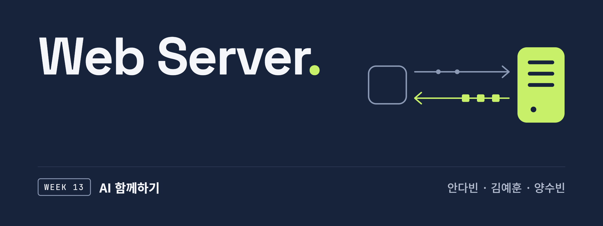
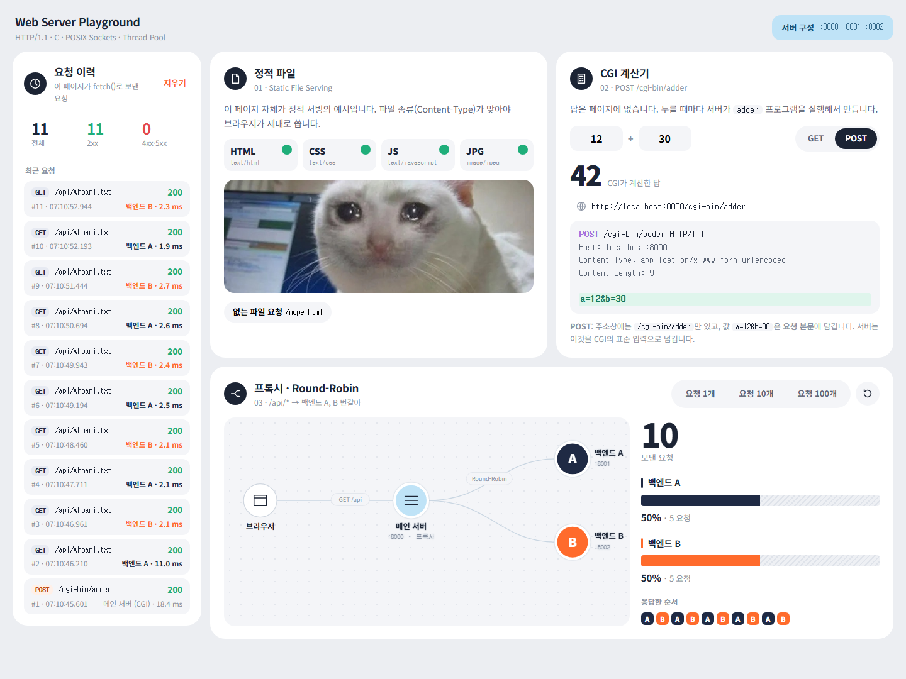
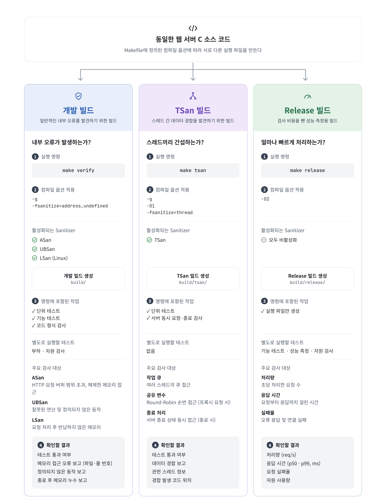

<p align="center">
  
</p>

[](https://github.com/hoon2005/Week13_webserver/actions/workflows/ci.yml)


Krafton Jungle 13주차 프로젝트입니다. C와 POSIX 소켓 API로 만든 HTTP/1.1 웹 서버이며 Reverse Proxy를 포함합니다.

[빠른 시작](#빠른-시작) · [구조와 설계](#3--시스템-구조와-설계-결정) · [데모](#4--web-server-playground-데모) · [검증](#5--검증) · [성능 분석](#6--성능-분석) · [문서](#문서)

## 1. ⭐ 무엇에 집중했나

정적 파일, CGI, 동시 처리, Reverse Proxy라는 과제의 필수 기능을 구현한 뒤 두 가지에 집중했습니다. **요청 하나의 실패가 서버 전체로 번지지 않게 하는 것**, 그리고 **검증과 측정으로 문제를 찾아 개선하는 것**입니다.

| 집중한 것 | 질문 | 한 일 |
|---|---|---|
| **장애 격리** | 요청 하나가 잘못돼도 서버가 계속 동작하는가? | 느린 클라이언트, 멈춘 CGI, 꺼진 백엔드로 생긴 실패는 그 요청만 오류로 끝냅니다. |
| **측정 기반 개선** | 문제와 한계를 추측이 아니라 근거로 설명할 수 있는가? | 12개 항목(F1~F12)을 수정하고, 44ms 지연 개선과 동시 접속의 한계를 측정으로 확인했습니다. |

## 2. 기술 스택과 프로젝트 구조

### 기술 스택

| 영역 | 사용한 것 |
|---|---|
| 언어 | C11, POSIX API |
| 동시성 | pthread 스레드 풀, mutex, 조건 변수, C11 atomic |
| 외부 라이브러리 | 없음. CS:APP 제공 코드(`csapp.c`)에서 쓰기 함수 하나와 공통 상수를 사용 |
| 검사 도구 | ASan, UBSan, LSan, TSan, clang-format |
| 테스트와 측정 | acutest(단위), Python 3(기능, 부하), wrk, ab |
| 환경 | macOS, Linux(WSL2 포함). CI도 두 OS에서 실행 |

### 프로젝트 구조

```text
Week13_webserver/
├─ Makefile          make verify, make tsan, make release, make load
├─ src/
│  ├─ main/tiny.c       서버. 연결, 요청 읽기, 정적 파일, CGI, 종료
│  ├─ main/adder.c      CGI 예제 (덧셈)
│  ├─ http.c            요청 해석과 검사
│  ├─ proxy.c           라우팅, 백엔드 선택, 중계
│  └─ conn_queue.c      작업 큐
├─ demo/             브라우저 데모, 장애 시연
├─ tests/            단위, functional/, stress/, tsan/
└─ docs/
   ├─ prd/              설계 문서. final.md가 최종본
   ├─ measurements/     측정 기록
   └─ testing/          브라우저·로드밸런싱 수동 확인 기록
```

## 3. ⭐ 시스템 구조와 설계 결정

```text
                      ┌──────────────── 메인 서버 ────────────────┐
                      │                                           │
클라이언트 ─ 연결 ──▶ │ main 스레드 ─▶ 작업 큐 ─▶ 작업 스레드 16개 │
                      │                (64칸)        │            │
                      └──────────────────────────────┼────────────┘
                                                     │ 경로로 판단
                             ┌───────────────────────┼──────────────────────┐
                             ▼                       ▼                      ▼
                         정적 파일                  CGI              Reverse Proxy
                       폴더에서 읽음          프로그램을 실행        백엔드 A, B로 번갈아
```

### 요청 처리 흐름

```text
1. 읽기     요청 줄과 헤더 (마감 10초)
2. 검사     형식, 버전, 메서드, 헤더         잘못되면 4xx·5xx
3. 본문     Content-Length만큼 (마감 30초)   1 MiB 초과는 413
4. 경로     "..", ".", 빈 조각이 있으면 403
5. 라우팅   규칙에 맞으면 백엔드로, 아니면 직접 처리
6. 응답     보낸 뒤 연결을 유지할지 판단      연결당 최대 100건
```

시간은 기본 설정(`--timeout 5`) 기준입니다.

### LMS 요구사항과 우리의 선택

과제가 정한 것은 "무엇을"이고, "어떻게"는 우리가 골랐습니다. 굵은 글씨가 핵심 결정입니다.

| LMS 요구사항 | 우리의 선택 | 이유 |
|---|---|---|
| 동시 요청 처리 (스레드 풀 권장) | **스레드 풀 16개 + 작업 큐 64칸** | 스레드 수가 고정됩니다. 쉬는 연결이 자리를 차지하는 단점은 시간 제한과 연결당 100건 상한으로 줄입니다. [기록](docs/prd/final.md#2-스레드-풀) |
| 동적 요청 처리 | **CGI 출력을 모두 받은 뒤 응답** | 먼저 `200`을 보내면 실패해도 성공으로 보입니다. 실패는 `500`, 시간 초과는 `504`입니다. [기록](docs/prd/final.md#4-cgi-입력은-임시-파일-출력은-파이프로-모은다) |
| Forward 또는 Reverse Proxy, 로드 밸런싱(권장) | **Reverse Proxy + Round-Robin. 연결에 실패했을 때만 다음 백엔드 시도** | 요청을 보낸 뒤 다시 시도하면 같은 POST가 두 번 처리될 수 있습니다. [기록](docs/prd/final.md#9-연결-실패에만-다른-백엔드를-시도한다) |
| 잘못된 요청과 끊김 등 엣지 케이스 | **타임아웃에 더해 읽는 단계마다 마감** | 조금씩 천천히 보내는 공격(Slowloris)은 타임아웃만으로 막지 못합니다. [기록](docs/prd/final.md#10-요청을-읽는-단계마다-마감을-둔다) |
| 라우팅, 정적 파일 | 경로 접두사로 판단, 잘못된 경로는 `403` | 프록시와 백엔드가 경로를 다르게 해석하는 틈을 막습니다. [기록](docs/prd/final.md#12-경로가-잘못되면-고치지-않고-거절한다) |
| 안전한 종료 (SIGINT, SIGTERM) | 시그널 전용 스레드 | 처리 중인 요청을 마치고 자원을 정리합니다. [기록](docs/prd/final.md#11-시그널-전용-스레드로-종료한다) |
| C와 POSIX API, 이식성 | 외부 라이브러리 없음, macOS·Linux 지원 | OS마다 다른 함수만 나눠 쓰고 CI를 두 OS에서 실행합니다. |

요구사항 전체의 충족 현황은 [최종 PRD 3장](docs/prd/final.md#3-요구사항과-달성-현황)에 있습니다.

## 4. ⭐ Web Server Playground 데모

<p align="center">
  
</p>

화면 뒤에서 실제 서버 3개가 실행됩니다. 같은 프로그램(`build/tiny`)을 폴더와 포트만 바꿔 띄운 것입니다.

```text
                         ┌─ 정적 파일, CGI   메인 서버가 직접 처리
브라우저 ──▶ 메인 서버 ──┤
             :8000       └─ /api            번갈아 전달 ─┬─▶ 백엔드 A  :8001
                                                        └─▶ 백엔드 B  :8002
```

| 순서 | 할 일 | 보이는 것 |
|---|---|---|
| ① 정적 파일 | 페이지를 엽니다. | 이 페이지와 사진을 우리 서버가 보냅니다. 없는 파일은 `404`입니다. |
| ② CGI | 12와 30을 더합니다. | GET은 값이 주소에, POST는 본문에 담기고 결과는 같은 42입니다. |
| ③ Round-Robin | 요청 10개를 보냅니다. | 백엔드 A와 B가 5개씩 응답합니다. |

A와 B는 백엔드가 보낸 응답 본문으로 구분합니다. 백엔드가 꺼지는 상황은 `./demo/lb.sh`로 확인합니다. [데모 실행 방법](demo/README.md)

## 5. ⭐ 검증

시나리오 139개를 다섯 가지 품질로 나눠 확인했습니다.

| 품질 | 질문 | 시나리오 |
|---|---|---:|
| 정확성 | 정상 요청에 맞게 응답하는가? | 61 |
| 견고성 | 잘못된 요청과 장애에도 서버가 유지되는가? | 43 |
| 동시성 | 여러 요청이 서로 간섭하지 않는가? | 16 |
| 성능 | 부하에 따라 성능이 어떻게 변하는가? | 8 |
| 자원 관리 | 메모리, fd, 프로세스를 돌려주는가? | 11 |

### 같은 코드를 세 가지로 빌드했습니다

검사 도구를 켜면 서버가 느려지고, 도구끼리 함께 켤 수 없는 것도 있습니다. 그래서 **오류는 개발 빌드, 스레드 충돌은 TSan 빌드, 성능은 Release 빌드**에서 확인합니다.

<p align="center">
  
</p>

<details>
<summary>빌드별 옵션과 검사 대상 자세히 보기</summary>

<p align="center">
  
</p>

</details>

### 검토에서 찾은 문제를 고쳤습니다

12개 항목(F1~F12)을 수정했습니다. F1~F11에는 회귀 테스트를 추가했고, F12는 코드 포맷 검사로 확인합니다.

| 예 | 고치기 전 | 고친 뒤 |
|---|---|---|
| F1 성능 | 작은 응답이 약 44ms 늦음 | `TCP_NODELAY`로 해결 |
| F3 보안 | 요청의 HTML 태그가 오류 페이지에 그대로 들어감 | 특수문자를 변환해 글자로 표시 |
| F9 기능 | `/style.css?v=2`처럼 쿼리가 붙은 파일을 못 찾음 | `?` 앞 경로로 찾음 |

### 최종 실행 결과

| 검사 | 결과 |
|---|---|
| 단위·기능·포맷 | 단위 29개, 기능 101개 통과, 건너뜀 없음 |
| 데이터 경합 (TSan) | 보고 없음 |
| 부하 중 누수 10분 | 약 65만 건, 오류와 Sanitizer 보고 0건 |
| 장시간 자원 10분 (Release) | **약 811만 건, 오류 0건.** 시작과 끝의 fd·스레드·좀비 수가 같음 |
| 스트레스 5개 | 기대와 모두 일치. 정상 요청이 다시 `200`을 받음 |

커밋 `8cce3c1`, WSL2 Ubuntu에서 실행한 결과입니다.

[수정 목록](docs/prd/M8우선수정목록.md) · [실행 결과](docs/measurements/001-m8-validation.md#테스트-결과) · [직접 실행하기](#검증-명령)

## 6. ⭐ 성능 분석

### 문제: 작은 응답만 44ms 늦었습니다

헤더와 작은 본문을 나눠 보낼 때, 서버(Nagle)는 수신 확인을 기다리고 클라이언트(Delayed ACK)는 수신 확인을 미룬 것으로 봅니다. `TCP_NODELAY`로 기다리지 않고 보내게 했습니다.

| 같은 코드에서 옵션만 비교 | 끔 | 켬 |
|---|---:|---:|
| 처리량 (req/s) | 232 | **69,600** |
| p50 (ms) | 43.98 | **0.13** |

작은 파일을 접속 10개로, 한 컴퓨터 안에서 쟀습니다. 원래 지연이 없던 큰 파일에는 해당하지 않습니다. p50은 요청의 절반, p99는 99%가 끝난 시간입니다.

### 지금: 접속이 늘어도 처리량은 유지됩니다

| 동시 접속 | 4 | 16 | 32 | 256 |
|---|---:|---:|---:|---:|
| 처리량 (req/s) | 79,523 | 71,231 | 71,024 | 69,583 |
| p50 (ms) | 0.04 | 0.23 | 0.34 | 0.51 |
| p99 (ms) | 0.13 | 0.74 | **22.81** | **338.94** |

처리량은 8개부터 약 7만 건을 유지하고 오류는 없었습니다. 하지만 접속이 스레드 16개를 넘자 느린 1%가 급격히 느려졌습니다.

### 원인: 스레드 자리를 기다립니다

작업 스레드는 연결 하나를 맡아 최대 100건을 처리합니다. 자리가 없는 연결은 앞 연결이 끝날 때까지 기다립니다. 접속을 32개로 고정하고 스레드만 바꿔 확인했습니다.

<p align="center">
  
</p>

스레드가 접속 수와 같아지자 p99가 22.47ms에서 1.48ms로 줄었습니다. 기본값은 16을 유지했습니다. 32개에서는 처리량이 약 5% 줄었고, 접속이 더 늘면 같은 기다림이 다시 생길 것으로 보기 때문입니다.

[측정 조건, 전체 표, 원본](docs/measurements/001-m8-validation.md)

## 7. 실행과 사용법

### 빠른 시작

C 컴파일러와 `make`, `curl`이 필요합니다. 설치 방법은 [CONVENTION.md](CONVENTION.md#개발-환경)에 있습니다.

```bash
make               # 빌드
./demo/web.sh      # 서버 3개를 띄움. 브라우저에서 http://localhost:8000/
```

서버 하나만 실행할 수도 있습니다.

```bash
./build/tiny 8000 --root tests/fixtures/www
```

끌 때는 Ctrl+C를 누릅니다.

### 실행 인자

```text
./build/tiny <port> [--root DIR] [--threads N] [--queue N] [--timeout 초] [--keepalive-max N]
                    [--route 접두사=이름:포트[,이름:포트...]]... [--proxy-timeout 초]
```

| 인자 | 기본값 | 설명 |
|---|---|---|
| `--root` | 현재 폴더 | 정적 파일과 CGI를 찾는 폴더 |
| `--threads` / `--queue` | 16 / 64 | 작업 스레드 수 / 작업 큐 크기 |
| `--timeout` | 5 | 요청을 읽을 때의 타임아웃(초) |
| `--keepalive-max` | 100 | 연결 하나에서 처리하는 최대 요청 수 |
| `--route` | 없음 | 라우팅 규칙. 예: `/api=127.0.0.1:8001,127.0.0.1:8002` |
| `--proxy-timeout` | 10 | 백엔드 연결부터 응답 헤더까지의 마감, 응답 본문의 타임아웃(초) |

### 요청 예시

`./demo/web.sh`를 실행한 뒤 다른 터미널에서 확인합니다.

```console
$ curl "http://localhost:8000/cgi-bin/adder?1&2"
Welcome to add.com: THE Internet addition portal.
<p>The answer is: 1 + 2 = 3
<p>Thanks for visiting!
```

`/api/whoami.txt`를 요청하면 A와 B가 번갈아 응답합니다.

```console
$ curl http://localhost:8000/api/whoami.txt
나는 서버 A (포트 8001)
$ curl http://localhost:8000/api/whoami.txt
나는 서버 B (포트 8002)
```

모든 응답 코드와 크기·시간 제한은 [최종 PRD 6장](docs/prd/final.md#6-응답-코드와-시간크기-제한)에 있습니다.

### 검증 명령

| 검사 | 무엇을 확인하나 | 명령 |
|---|---|---|
| 단위 29개, 기능 101개, 코드 포맷 | 모듈과 실제 서버의 응답, 메모리 오류와 누수 | `make verify` |
| 데이터 경합 | 단위 테스트, 서버의 동시 요청과 종료 | `make tsan` |
| 부하 중 누수 | 접속 32개로 부하를 준 뒤 종료 | `python3 -B tests/stress/soak.py asan-load` |
| 스트레스 5개 | 과부하 뒤 정상 요청의 회복 (직접 대조) | `python3 -B tests/stress/stress.py` |
| 장시간 자원 | 10분 동안 fd, 메모리, 스레드, 좀비 (Linux) | `python3 -B tests/stress/soak.py long-run` |
| 성능 | 처리량, p50, p99 (wrk, ab 필요, 약 30분) | `make load` |

스트레스와 장시간 자원 검사는 `make`와 `make release`를 먼저 실행합니다. 부하 중 누수 검사는 `make`만 있으면 됩니다. 실행 결과는 [M8 검증 기록](docs/measurements/001-m8-validation.md#테스트-결과)에 있습니다. CI는 Ubuntu와 macOS에서 `make verify`와 `make tsan`을 실행합니다.

## 8. 마일스톤과 참고 자료

### 마일스톤

| 순서 | 주제 | 문서 |
|---|---|---|
| M1~M3 | 소켓 연결, 정적 파일, CGI (CS:APP Tiny를 팀 코드로 교체) | [phase1](docs/prd/phase1.md) |
| M4~M5 | 스레드 풀, POST와 연결 유지, CGI 오류 응답 | [m4m5](docs/prd/m4m5.md) |
| M6~M7 | Reverse Proxy, Round-Robin, 요청 검사, 안전한 종료 | [m6m7](docs/prd/m6m7.md) |
| M8 | 품질 검증, F1~F12 수정, 부하 측정 | [검증 기록](docs/measurements/001-m8-validation.md), [수정 목록](docs/prd/M8우선수정목록.md) |

### 알려진 한계

- **연결이 작업 스레드보다 많으면 일부가 기다립니다.** 작업 큐가 가득 차도 `503`을 보내지 않고 기다립니다.
- chunked 요청 본문은 `501`로 거절합니다.
- 백엔드 상태를 미리 확인하지 않고, 요청마다 백엔드에 새로 연결합니다.
- 성능은 한 컴퓨터 안에서 쟀습니다. 약 7만 건에서 멈추는 원인은 확인하지 못했습니다.

전체 목록은 [최종 PRD 10장](docs/prd/final.md#10-한계와-남은-일)에 있습니다.

### 문서

- [`docs/prd/final.md`](docs/prd/final.md): 최종 PRD. 요구사항, 구조, 설계 결정, 한계
- [`docs/measurements/`](docs/measurements/): 측정 기록
- [`demo/README.md`](demo/README.md): 데모 실행 방법
- [`CONVENTION.md`](CONVENTION.md): 팀 규칙, 개발 환경, 빌드 명령

---

안다빈 · 김예훈 · 양수빈
