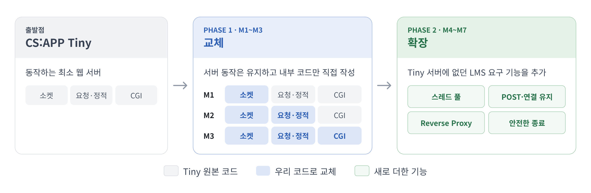
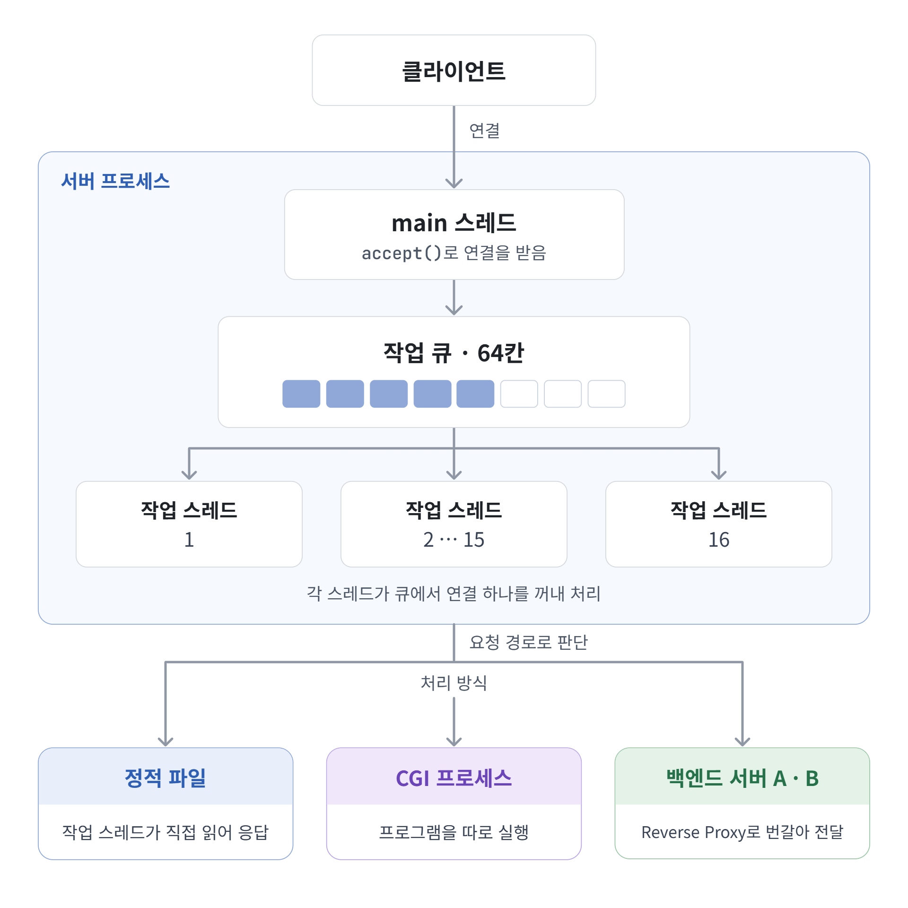
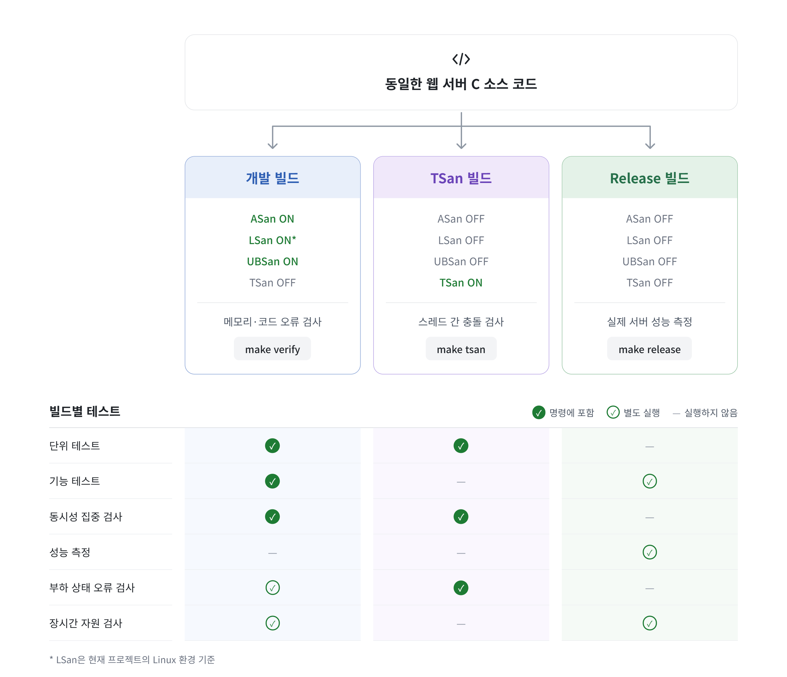
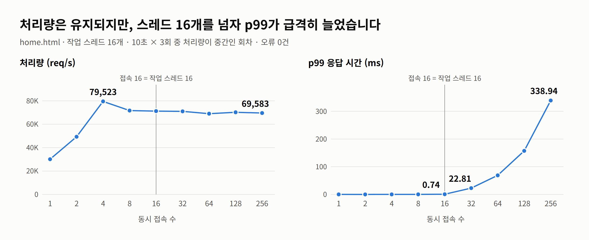
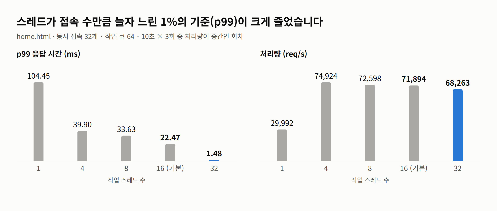

<p align="center">
  
</p>

[](https://github.com/hoon2005/Week13_webserver/actions/workflows/ci.yml)


Krafton Jungle 13주차 팀 프로젝트. C와 POSIX 소켓으로 구현한 HTTP/1.1 웹 서버와 리버스 프록시.

[빠른 시작](#빠른-시작) · [구조와 설계](#3--시스템-구조와-설계-결정) · [시연](#4--시연) · [검증](#5--검증) · [성능 분석](#6--성능-분석) · [검증 실행](docs/testing/validation-guide.md#명령어-요약) · [문서](#문서)

## 1. ⭐ 구현 범위

### Tiny에서 시작한 이유와 교체 범위

CS:APP의 Tiny를 교체 전후 동작을 비교할 기준으로 삼았습니다. Tiny는 소켓 연결, 정적 파일 응답, CGI 실행까지 갖춘 교육용 웹 서버입니다.

- Phase 1에서 Tiny의 서버 코드를 모두 교체했습니다. CS:APP 공통 코드(`csapp.c`)에서는 쓰기 함수 하나와 공통 상수만 사용합니다.
- 교체 전후에 같은 요청 14개를 보내 응답이 바이트 단위로 일치하는지 확인했습니다. 보안을 위해 응답을 바꾼 경로 탈출 요청(`../`)은 비교에서 제외했습니다. [교체 기록](docs/prd/phase1.md#교체-확인)

<p align="center">
  
</p>

| Tiny | 우리 서버 |
|---|---|
| 한 번에 한 연결만 처리 | 스레드 풀로 동시에 처리 |
| HTTP/1.0 응답, GET만 지원, 헤더를 버림 | HTTP/1.1, GET·POST·HEAD, 연결 유지 |
| 클라이언트 하나의 오류로 서버가 꺼질 수 있음 | 문제가 생긴 요청만 끝냄 |
| CGI가 실패해도 `200` | 실패는 `500`, 시간 초과는 `504` |

### 장애 대응과 검증

- 클라이언트가 너무 느리거나 CGI·백엔드가 응답하지 않아도 서버는 계속 요청을 받습니다. [시연과 장애 대응](#4--시연)
- 검토에서 찾은 문제 12개를 수정하고 검증했습니다. 부하를 주면서 처리량과 늦은 응답이 얼마나 달라지는지도 측정했습니다. [검증](#5--검증) · [성능 분석](#6--성능-분석)

## 2. 기술 스택과 프로젝트 구조

### 기술 스택

| 영역 | 사용한 것 |
|---|---|
| 언어 | C11, POSIX API |
| 동시성 | pthread 스레드 풀, mutex, 조건 변수, C11 atomic |
| 외부 라이브러리 | 없음. CS:APP 제공 코드(`csapp.c`)에서 쓰기 함수 하나와 공통 상수를 사용 |
| 검사 도구 | ASan, UBSan, LSan, TSan, clang-format |
| 테스트와 측정 | acutest(단위), Python 3(기능, 부하), wrk, ab |
| 환경 | macOS, Linux(WSL2 포함). CI도 두 OS에서 실행 |

### 프로젝트 구조

```text
Week13_webserver/
├─ Makefile          make verify, make tsan, make release, make load
├─ src/
│  ├─ main/tiny.c       서버. 연결, 요청 읽기, 정적 파일, CGI, 종료
│  ├─ main/adder.c      CGI 예제 (덧셈)
│  ├─ http.c            요청 해석과 검사
│  ├─ proxy.c           라우팅, 백엔드 선택, 중계
│  └─ conn_queue.c      작업 큐
├─ demo/             브라우저 데모, 장애 시연
├─ tests/            단위, functional/, stress/, tsan/
└─ docs/
   ├─ prd/              설계 문서. final.md가 최종본
   ├─ measurements/     측정 기록
   └─ testing/          테스트 시나리오, 검증 실행 방법
```

## 3. ⭐ 시스템 구조와 설계 결정

<p align="center">
  
</p>

### 요청 처리 흐름

```text
1. 읽기     요청 줄과 헤더 (마감 10초)
2. 검사     형식, 버전, 메서드, 헤더         잘못되면 4xx·5xx
3. 본문     Content-Length만큼 (마감 30초)   1 MiB 초과는 413
4. 경로     "..", ".", 빈 조각이 있으면 403
5. 라우팅   규칙에 맞으면 백엔드로, 아니면 직접 처리
6. 응답     보낸 뒤 연결을 유지할지 판단      연결당 최대 100건
```

시간은 기본 설정(`--timeout 5`) 기준입니다.

### 요구사항별 구현과 설계

| LMS 요구사항 | 구현·설계 |
|---|---|
| 동시 요청 처리 | 작업 스레드 16개 · 작업 큐 64칸 |
| 동적 요청 처리 | CGI 실행 결과를 확인한 뒤 응답 |
| 프록시 · 로드 밸런싱 | Reverse Proxy · Round-Robin |
| 잘못된 요청과 연결 끊김 | 요청 형식 검사 · 헤더와 본문 읽기 마감 |
| 라우팅 · 정적 파일 | 경로 접두사로 라우팅 · 잘못된 경로는 `403` |
| 안전한 종료 | 시그널 전용 스레드에서 `SIGINT`·`SIGTERM` 처리 |
| C와 POSIX API · 이식성 | 외부 라이브러리 없이 macOS·Linux 지원 |

- 스레드 수를 고정하고, 연결 유지 시간과 연결당 요청 수(최대 100건)를 제한했습니다. 응답 후 쉬는 연결이 작업 스레드를 오래 점유하는 상황을 줄이기 위한 설정입니다. [스레드 풀 설계](docs/prd/final.md#2-스레드-풀)
- CGI는 출력을 모두 받아 실행 결과를 확인한 뒤 응답합니다. 실행 실패는 `500`, 시간 초과는 `504`로 구분합니다. [CGI 응답 설계](docs/prd/final.md#4-cgi-입력은-임시-파일-출력은-파이프로-모은다)
- 다른 백엔드는 연결에 실패했을 때만 시도합니다. 이미 전달한 POST를 다시 보내면 같은 작업이 두 번 처리될 수 있습니다. [프록시 재시도 기준](docs/prd/final.md#9-연결-실패에만-다른-백엔드를-시도한다)

<details>
<summary>요청 읽기, 경로 검사, 종료와 이식성</summary>

- 헤더와 본문을 읽는 단계에 각각 마감을 둡니다. 클라이언트가 데이터를 조금씩 보내도 단계 전체의 읽기 시간은 제한됩니다. [읽기 마감](docs/prd/final.md#10-요청을-읽는-단계마다-마감을-둔다)
- 잘못된 경로는 `403`으로 응답합니다. 서버가 요청을 전달하기 전에 경로를 검사해, 프록시와 백엔드가 경로를 다르게 해석할 여지를 줄입니다. [경로 검사](docs/prd/final.md#12-경로가-잘못되면-고치지-않고-거절한다)
- 종료 신호를 받으면 진행 중인 요청을 마친 뒤 자원을 정리합니다. [종료 흐름](docs/prd/final.md#11-시그널-전용-스레드로-종료한다)
- OS마다 다른 함수는 분리하고, macOS와 Linux에서 CI를 실행합니다.

</details>

요구사항 전체의 충족 현황은 [최종 PRD 3장](docs/prd/final.md#3-요구사항과-달성-현황)에 있습니다.

## 4. ⭐ 시연

<p align="center">
  
</p>

저장소 루트에서 빌드하고 시연 서버를 띄웁니다. 시연 스크립트에 `curl`이 필요합니다. 브라우저에서 `http://localhost:8000/`을 엽니다.

```bash
make
./demo/web.sh
```

같은 서버 프로그램(`build/tiny`)이 세 개 실행됩니다. 메인 서버(`8000`)는 정적 파일과 CGI를 직접 처리하고, `/api`로 시작하는 요청은 백엔드 A(`8001`)와 B(`8002`)에 번갈아 전달합니다.

- 정적 파일을 확인합니다. 메인 서버가 페이지와 사진을 보내고, ‘없는 파일 요청’ 버튼을 누르면 `404`가 표시됩니다.
- CGI 계산기에서 `12 + 30`을 GET과 POST로 각각 보냅니다. 결과는 둘 다 `42`입니다. 요청 원문에서 GET은 주소에, POST는 본문에 두 숫자가 들어 있는 걸 확인할 수 있습니다.
- Round-Robin에서 요청 10개를 보냅니다. 응답 본문에 표시된 백엔드 이름을 기준으로 A와 B에 5개씩 집계됩니다.

브라우저 시연을 끝내려면 터미널에서 `Ctrl+C`를 누릅니다. 이어서 `./demo/lb.sh`를 실행하면 백엔드가 꺼졌을 때의 동작을 볼 수 있습니다. [전체 시연 방법](demo/README.md)

## 5. ⭐ 검증

[시나리오 139개](docs/testing/scenarios.csv)를 다섯 가지 품질로 나눠 확인했습니다.

| 품질 | 질문 | 시나리오 |
|---|---|---:|
| 정확성 | 정상 요청에 맞게 응답하는가? | 61 |
| 견고성 | 잘못된 요청과 장애에도 서버가 유지되는가? | 43 |
| 동시성 | 여러 요청이 서로 간섭하지 않는가? | 16 |
| 성능 | 부하에 따라 성능이 어떻게 변하는가? | 8 |
| 자원 관리 | 메모리, 파일·소켓, 자식 프로세스를 정리하는가? | 11 |

### 빌드별 검증 범위

검사 도구는 실행 속도에 영향을 주고 함께 켤 수 없는 조합도 있어서, 확인할 항목에 따라 같은 코드를 세 가지로 빌드합니다.

- 개발 빌드는 기능과 메모리 오류, 누수를 확인합니다.
- TSan 빌드는 여러 스레드가 같은 메모리를 동시에 다룰 때 생기는 데이터 경합을 검사합니다.
- Release 빌드는 검사 도구를 끈 상태에서 실제 동작과 성능을 확인합니다.

<p align="center">
  
</p>

<details>
<summary>빌드별 옵션과 검사 대상 자세히 보기</summary>

<p align="center">
  
</p>

</details>

### 발견한 문제와 수정

12개 항목을 수정했습니다. F1부터 F11까지는 회귀 테스트로, F12는 코드 포맷 검사로 확인했습니다.

| 예 | 고치기 전 | 고친 뒤 |
|---|---|---|
| F2 견고성 | 응답 전송에 실패해도 닫기 전에 최대 1초를 더 기다림 | 전송에 실패하면 바로 닫음 |
| F3 보안 | 요청의 HTML 태그가 오류 페이지에 그대로 들어감 | 특수문자를 변환해 글자로 표시 |
| F9 기능 | `/style.css?v=2`처럼 쿼리가 붙은 파일을 못 찾음 | `?` 앞 경로로 찾음 |

### 최종 실행 결과

| 검사 | 결과 |
|---|---|
| 단위·기능·포맷 | 단위 29개, 기능 101개 통과, 건너뜀 없음 |
| 데이터 경합 (TSan) | 보고 없음 |
| 부하 중 누수 10분 | 약 65만 건, 오류와 Sanitizer 보고 0건 |
| 장시간 자원 10분 (Release) | **약 811만 건, 오류 0건.** 시작과 끝의 fd·스레드·좀비 수가 같음 |
| 스트레스 5개 | 기대와 모두 일치. 정상 요청이 다시 `200`을 받음 |

커밋 `8cce3c1`, WSL2 Ubuntu에서 실행한 결과입니다.

[수정 내용 전체](docs/measurements/001-m8-validation.md#발견한-문제와-수정) · [실행 결과](docs/measurements/001-m8-validation.md#테스트-결과) · [직접 실행하기](docs/testing/validation-guide.md#명령어-요약)

## 6. ⭐ 성능 분석

응답 시간을 짧은 순서대로 놓으면 p50은 가운데 값입니다. p99가 20ms라면 요청의 99%가 20ms 안에 응답을 받았다는 뜻입니다.

### A. 동시 접속 수에 따른 처리량과 p99

- **측정 조건** — 작업 스레드 16개로 작은 정적 파일(`home.html`)을 제공하고, 동시 접속을 1개부터 256개까지 늘렸습니다.
- **주요 결과** — 접속 16개에서 32개로 늘렸을 때 처리량은 초당 약 7만 건을 유지했고, p99는 `0.74ms → 22.81ms`로 늘었습니다.

<p align="center">
  
</p>

동시 접속이 256개일 때도 요청의 절반은 약 0.5ms 안에 끝났습니다. 같은 조건의 p99는 약 339ms였습니다. 처리량과 p50만 보면 이렇게 늦어진 응답이 잘 드러나지 않습니다.

### B. 작업 스레드 수에 따른 처리량과 p99

- **측정 조건** — `home.html`, 동시 접속 32개, 작업 큐 64칸을 유지하고 작업 스레드를 `1·4·8·16·32개`로 바꿨습니다.
- **주요 결과** — 작업 스레드를 16개에서 32개로 늘리자 p99는 `22.47ms → 1.48ms`로 줄었습니다. 처리량도 `71,894 → 68,263건/초`로 약 5% 줄었습니다.

<p align="center">
  
</p>

작업 스레드 하나는 연결 하나에서 최대 100건을 처리합니다. 비어 있는 스레드가 없으면 새 연결은 큐에서 기다립니다. 동시 접속 32개에 스레드 32개를 맞췄을 때 p99가 줄어든 결과는 이 대기 시간의 영향을 보여 줍니다.

기본값은 16개로 유지했습니다. 스레드를 32개로 늘리면 이 실험에서 처리량이 줄었고, 접속 수가 스레드 수를 넘으면 대기가 다시 생길 수 있기 때문입니다.

한 컴퓨터 안에서 잰 결과입니다. [측정 조건, 전체 표, 원본](docs/measurements/001-m8-validation.md)

## 7. 실행과 사용법

### 빠른 시작

C 컴파일러와 `make`가 필요합니다. 설치 방법은 [개발 환경](CONVENTION.md#개발-환경)을 참고합니다. 정적 파일을 제공하는 서버 하나를 실행합니다.

```bash
make
./build/tiny 8000 --root tests/fixtures/www
```

브라우저에서 `http://localhost:8000/home.html`을 엽니다. 서버를 끌 때는 `Ctrl+C`를 누릅니다. CGI 계산기와 프록시를 함께 보려면 [시연](#4--시연)의 명령을 실행합니다.

### 실행 인자

```text
./build/tiny <port> [--root DIR] [--threads N] [--queue N] [--timeout 초] [--keepalive-max N]
                    [--route 접두사=이름:포트[,이름:포트...]]... [--proxy-timeout 초]
```

| 인자 | 기본값 | 설명 |
|---|---|---|
| `--root` | 현재 폴더 | 정적 파일과 CGI를 찾는 폴더 |
| `--threads` / `--queue` | 16 / 64 | 작업 스레드 수 / 작업 큐 크기 |
| `--timeout` | 5 | 요청을 읽을 때의 타임아웃(초) |
| `--keepalive-max` | 100 | 연결 하나에서 처리하는 최대 요청 수 |
| `--route` | 없음 | 라우팅 규칙. 예: `/api=127.0.0.1:8001,127.0.0.1:8002` |
| `--proxy-timeout` | 10 | 백엔드 연결부터 응답 헤더까지의 마감, 응답 본문의 타임아웃(초) |

### 요청 예시

`./demo/web.sh`를 실행한 뒤 다른 터미널에서 확인합니다.

```console
$ curl "http://localhost:8000/cgi-bin/adder?1&2"
Welcome to add.com: THE Internet addition portal.
<p>The answer is: 1 + 2 = 3
<p>Thanks for visiting!
```

`/api/whoami.txt`를 요청하면 A와 B가 번갈아 응답합니다.

```console
$ curl http://localhost:8000/api/whoami.txt
나는 서버 A (포트 8001)
$ curl http://localhost:8000/api/whoami.txt
나는 서버 B (포트 8002)
```

모든 응답 코드와 크기·시간 제한은 [최종 PRD 6장](docs/prd/final.md#6-응답-코드와-시간크기-제한)에 있습니다.

### 검증 실행 방법

- `make verify`로 단위·기능 테스트와 포맷을 확인하고, `make tsan`으로 데이터 경합을 검사합니다. CI도 Ubuntu와 macOS에서 두 명령을 실행합니다.
- 전체 실행 순서, 복사할 명령, 합격 기준과 로그 저장 위치는 [검증 실행 가이드](docs/testing/validation-guide.md#명령어-요약)에 있습니다.

## 8. 마일스톤과 참고 자료

### 마일스톤

| 순서 | 주제 | 문서 |
|---|---|---|
| M1~M3 | 소켓 연결, 정적 파일, CGI (CS:APP Tiny를 팀 코드로 교체) | [phase1](docs/prd/phase1.md) |
| M4~M5 | 스레드 풀, POST와 연결 유지, CGI 오류 응답 | [m4m5](docs/prd/m4m5.md) |
| M6~M7 | Reverse Proxy, Round-Robin, 요청 검사, 안전한 종료 | [m6m7](docs/prd/m6m7.md) |
| M8 | 품질 검증, F1~F12 수정, 부하 측정 | [검증 기록](docs/measurements/001-m8-validation.md), [수정 목록](docs/prd/M8우선수정목록.md) |

### 알려진 한계

- **연결이 작업 스레드보다 많으면 일부가 기다립니다.** 작업 큐가 가득 차도 `503`을 보내지 않고 기다립니다.
- chunked 요청 본문은 `501`로 거절합니다.
- 백엔드 상태를 미리 확인하지 않고, 요청마다 백엔드에 새로 연결합니다.
- 성능은 한 컴퓨터 안에서 쟀습니다. 동시 접속 8개부터 정적 파일 처리량이 초당 약 7만 건 수준에 머문 원인은 확인하지 못했습니다.

전체 목록은 [최종 PRD 10장](docs/prd/final.md#10-한계와-남은-일)에 있습니다.

### 문서

| 알고 싶은 것 | 문서 |
|---|---|
| 무엇을, 왜 이렇게 만들었나 | [최종 PRD](docs/prd/final.md): 요구사항, 구조, 설계 결정, 한계 |
| 어떻게 실행하고 시연하나 | [데모 실행 방법](demo/README.md), [CONVENTION.md](CONVENTION.md): 개발 환경, 빌드 명령, 팀 규칙 |
| 무엇을 검증했나 | [테스트 시나리오](docs/testing/scenarios.csv): 시나리오 139개와 확인하는 테스트. 열 설명과 분류 기준은 [읽는 법](docs/testing/scenarios-guide.csv) |
| 검증을 어떻게 다시 하나 | [검증 실행 방법](docs/testing/validation-guide.md): 순서, 합격 기준, 로그 남기기 |
| 검증 결과는 어떤가 | [M8 검증 기록](docs/measurements/001-m8-validation.md): 테스트 결과, 고친 문제, 성능, 한계 |

아래는 진행하면서 남긴 기록입니다. 그 시점의 생각이라 지금 코드와 다를 수 있고, 다르면 최종 PRD를 따릅니다.

| 기록 | 내용 |
|---|---|
| [phase1](docs/prd/phase1.md), [m4m5](docs/prd/m4m5.md), [m6m7](docs/prd/m6m7.md) | 마일스톤별 설계와 비교 |
| [M8 우선 수정 목록](docs/prd/M8우선수정목록.md) | F1~F12를 고치기 전 원인과 선택지 |
| [브라우저 확인](docs/testing/test-cases.md), [엣지 케이스](docs/testing/edge-cases.md) | 이전 데모 화면에서 손으로 확인한 결과. 일부 문제는 F9 등에서 고쳤습니다 |

---

안다빈 · 김예훈 · 양수빈
