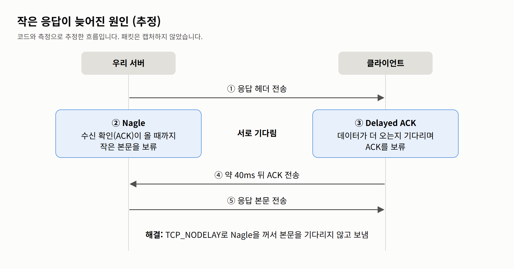
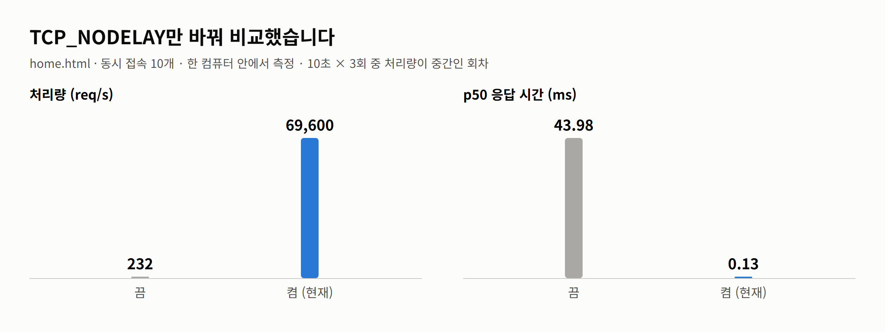
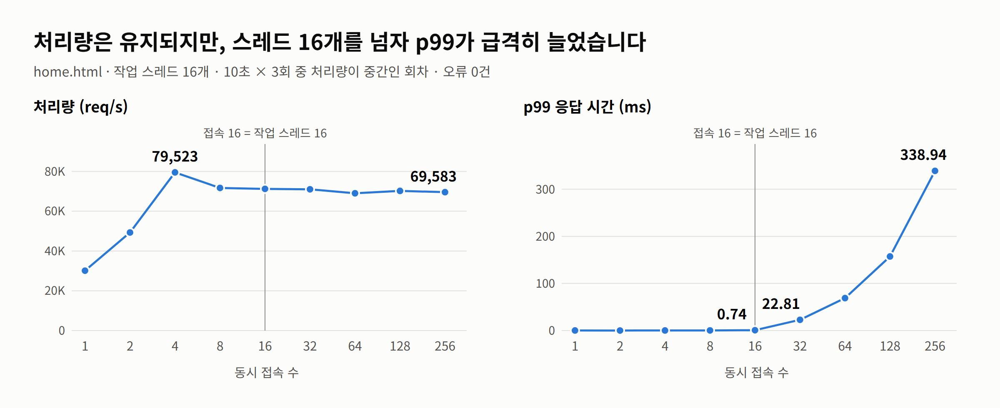
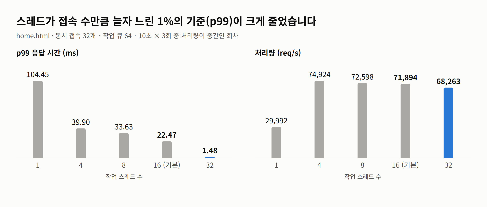

# M8 검증 기록: 성능과 테스트

## 결론

1. 작은 응답이 약 44ms씩 늦던 문제(F1)를 `TCP_NODELAY`로 고쳤습니다. 작은 파일을 접속 10개로 잰 결과 처리량이 초당 232건에서 69,600건이 됐습니다.
2. 작은 정적 파일은 접속 4개에서 최고 초당 79,523건, 8~256개에서 약 7만 건을 처리합니다. 오류는 0건입니다.
3. 접속이 작업 스레드(16개)보다 많으면 처리량은 유지되지만 일부 요청이 기다립니다. 접속 32개에서 스레드를 32개로 늘리자 p99가 22.47ms에서 1.48ms로 줄어, 스레드 자리 부족이 원인임을 확인했습니다.
4. `--threads` 기본값은 16, `--queue` 기본값은 64를 유지합니다. 큐 크기는 바꿔 가며 재지 않았습니다.

## 측정 조건

| 항목 | 값 |
| --- | --- |
| 서버 코드 | 커밋 `ac670ba`의 `src/`와 같음 |
| CPU, OS | Intel Core Ultra 9 275HX(24코어로 인식), WSL2 Ubuntu 26.04 |
| 빌드 | `make release` (`-O2`, Sanitizer 없음) |
| 서버 설정 | 작업 스레드 16, 작업 큐 64, 연결당 최대 100건 (B에서는 스레드만 변경) |
| 방법 | `wrk`(스레드 2개), 워밍업 3초, 10초 × 3회 중 처리량이 중간인 회차 |
| 한계 | 서버와 부하 도구가 한 컴퓨터의 CPU를 나눠 씀. 실제 네트워크 지연 없음 |

p50은 요청의 절반, p99는 요청의 99%가 그 시간 안에 끝났다는 뜻입니다.

원본에 적힌 커밋(`ac670ba`, `c67a618`)과 최종 커밋의 `src/`는 같습니다. 커밋이 `?`로 적힌 측정은 `TCP_NODELAY`만 끈 복사본에서 쟀습니다.

## F1: 44ms 지연

연결을 재사용하면 두 번째 요청부터 작은 응답이 약 44ms 늦었습니다. 헤더와 작은 본문을 나눠 보낼 때 서버와 클라이언트가 서로 기다린 것으로 보고, `TCP_NODELAY`로 서버가 기다리지 않게 했습니다(커밋 `c37e1be`).

  

같은 코드에서 접속 소켓의 `TCP_NODELAY`만 바꿔 `home.html`을 접속 10개로 쟀습니다.

| | 끔 | 켬 (현재) |
| --- | ---: | ---: |
| 처리량 | 232 req/s | 69,600 req/s |
| p50 | 43.98ms | 0.13ms |
| p99 | 44.29ms | 0.64ms |

  

- 약 300배는 이 조건의 값입니다. 수정 전 기록에서 100KB 이상의 파일에는 이 지연이 없었으므로 모든 요청에 해당하지 않습니다.
- Nagle과 Delayed ACK가 맞물린 것으로 보지만 패킷은 캡처하지 않았습니다.
- 처음 잰 "켬"은 37,767 req/s로 앞뒤 측정과 맞지 않았습니다. 다시 두 번 재서 65,610과 69,600 req/s를 얻었고, 끔과 이어서 잰 69,600을 사용했습니다. 처음 값이 낮았던 원인은 확인하지 못했습니다.

## A: 동시 접속 수

`home.html`, 작업 스레드 16개입니다.

  

| 접속 수 | 처리량 (req/s) | p50 | p99 |
| ---: | ---: | ---: | ---: |
| 1 | 30,094 | 0.03ms | 0.14ms |
| 2 | 49,314 | 0.04ms | 0.11ms |
| 4 | 79,523 | 0.04ms | 0.13ms |
| 8 | 71,694 | 0.10ms | 0.33ms |
| 16 | 71,231 | 0.23ms | 0.74ms |
| 32 | 71,024 | 0.34ms | 22.81ms |
| 64 | 69,023 | 0.42ms | 68.85ms |
| 128 | 70,204 | 0.46ms | 157.21ms |
| 256 | 69,583 | 0.51ms | 338.94ms |

포화 지점(최고 처리량의 95%에 처음 닿은 접속 수)은 4개입니다. 처리량이 약 7만 건에서 멈추는 원인은 확인하지 못했습니다.

| 요청 | 최고 처리량 (접속 수) | 접속 256개의 p99 |
| --- | ---: | ---: |
| 작은 파일 | 79,523 (4) | 0.34초 |
| 프록시 + 백엔드 2개 | 65,349 (128) | 0.36초 |
| 큰 파일 1 MiB | 18,859 (8, 도구 한계 표시) | 1.56초 |
| CGI | 4,624 (16) | 5.12초 |

## B: 작업 스레드 수

`home.html`, 접속 32개, 작업 큐 64입니다.

  

| 스레드 | 처리량 (req/s) | p50 | p99 |
| ---: | ---: | ---: | ---: |
| 1 | 29,992 | 0.07ms | 104.45ms |
| 4 | 74,924 | 0.08ms | 39.90ms |
| 8 | 72,598 | 0.19ms | 33.63ms |
| 16 (기본) | 71,894 | 0.33ms | 22.47ms |
| 32 | 68,263 | 0.50ms | 1.48ms |

작업 스레드는 요청이 아니라 연결 하나를 맡아 최대 100건을 처리한 뒤 닫습니다. 자리가 없는 연결의 첫 요청이 기다리므로 p50보다 p99에서 드러납니다.

16을 유지하는 이유는, 32로 늘리면 이 조건의 처리량이 약 5% 줄고 접속이 32개를 넘으면 같은 구조로 다시 기다릴 것으로 보기 때문입니다. 프록시와 CGI에서는 스레드 수를 바꿔 재지 않았습니다.

## 테스트 결과

| 검사 | 명령 | 결과 |
| --- | --- | --- |
| 단위·기능·포맷 | `make verify` | 통과. 단위 29개, 기능 101개, 포맷. 건너뜀 없음 |
| 부하 중 메모리 오류·누수 60초, 600초 | `soak.py asan-load` | 통과. 요청 125,262건, 651,785건. 오류 0건, 종료 코드 0, Sanitizer 보고 0건 |
| 데이터 경합 | `make tsan` | 통과. 단위 29개, 서버 1개. 데이터 경합 보고 없음 |
| Release 기능 | `baseline_test.py`, `scenario_test.py` | 통과. 20개, 건너뜀 없음 |
| 스트레스 5개 | `stress.py` | 5개 모두 기대와 일치 (아래 표) |
| 장시간 자원 10분 | `soak.py long-run` | 통과. 요청 8,110,165건, 오류 0건. 시작과 부하 뒤 fd 6, 스레드 18, 좀비 0. 부하 중 RSS 4,412~4,416 KB |

2026-11-26에 커밋 `8cce3c1`에서 실행했습니다. 환경은 성능 측정과 같고 gcc 15.2.0, Python 3.14.4, clang-format 21.1.8을 썼습니다. 이 커밋의 `src/`는 성능을 잰 코드와 같습니다.

스트레스 검사는 통과를 자동으로 판정하지 않으므로 출력의 기대와 결과를 대조했습니다. 5개 모두 일치했습니다.

| 시나리오 | 기대 | 결과 |
| --- | --- | --- |
| 유휴 연결 300개 | `200`, 대기 93.8초 이하 | `200`, 89.8초 |
| keep-alive 연결 16개가 자리 점유 | 점유 연결이 끊긴 뒤 `200` | `200`, 19.0초 대기 |
| 느린 CGI 16개 | CGI 모두 `504`, 정적 `200` | `504` 16건, 정적 `200`(9.5초 대기) |
| 프록시 순환 | 순환 `504`, 정적 `200` | `504`(3.0초), `200`(2.8초 대기) |
| 큰 헤더 | `400`, 이후 정상 요청 `200` | `400`, `200` |

## 발견한 문제와 수정

M8 검증을 준비하면서 코드와 문서를 대조해 12개 항목을 찾았습니다. F1~F11은 고치기 전 코드에서 실패하는 회귀 테스트를 쓰고, 고친 뒤 통과하는지 확인했습니다. F12는 포맷 검사로 확인합니다. 회귀 테스트는 `tests/functional/m8fix_test.py`에 있습니다.

| ID | 영역 | 고치기 전 | 고친 뒤 | 커밋 | 확인 |
| --- | --- | --- | --- | --- | --- |
| F1 | 성능 | 같은 연결의 두 번째 요청부터 작은 응답이 약 44ms 늦음 | `TCP_NODELAY`로 대기 없이 보냄 (위 F1 절) | `c37e1be` | `F1NagleTest` |
| F2 | 견고성 | 응답 전송에 실패해도 닫기 전에 최대 1초를 더 기다림 | 전송에 실패하면 바로 닫음 | `bd052b3` | `F2SendFailureTest` |
| F3 | 보안 | 요청의 HTML 태그가 404·403 오류 페이지에 그대로 들어감 | 특수문자를 변환해 글자로 표시 | `784df67` | `F3ErrorPageEscapeTest` |
| F4 | HTTP 규칙 | 중계한 HEAD + 204 응답에 `Content-Length`가 붙음 | 204에는 `Content-Length`를 보내지 않음 | `094daf1` | `F4Head204Test` |
| F5 | HTTP 규칙 | 요청 줄 검사에 실패한 HEAD의 오류 응답에 본문이 붙음 | HEAD의 오류 응답은 헤더만 보냄 | `f67dcbd` | `F5HeadErrorBodyTest` |
| F6 | CGI | CGI가 받는 `PATH`가 1,018바이트에서 잘림 | 자르지 않고 그대로 넘김 | `6133326` | `F6LongPathTest` |
| F7 | CGI | `adder`가 큰 입력 하나만 있어도 거절 | 합이 `int` 범위 안이면 계산 | `05ca9a1` | `F7AdderRangeTest` |
| F8 | CGI | CGI의 상태와 헤더를 거의 그대로 반영 | 중계 응답과 같은 HTTP 규칙으로 검사 | `85bbb17` | `F8CgiOutputRulesTest` |
| F9 | 기능 | 쿼리가 붙은 정적 파일을 못 찾고, 경로 중간의 `cgi-bin`도 CGI로 처리 | `?` 앞 경로로 찾고, 첫 조각이 `cgi-bin`일 때만 CGI | `eca3b10` | `F9QueryAndCgiPathTest` |
| F10 | HTTP 규칙 | 형식이 틀린 `Host` 값도 통과 | `400`으로 거절 | `fb2dd75` | `F10HostFormatTest` |
| F11 | HTTP 규칙 | `Connection` 값의 앞 255바이트만 봐서 뒤쪽의 `close`를 놓침 | 값을 끝까지 읽음 | `9a88436` | `F11LongConnectionValueTest` |
| F12 | 코드 품질 | `tiny.c`와 `adder.c`가 포맷 검사에서 빠짐 | 검사에 다시 포함 | `aa42f88` | `make verify`의 포맷 검사 |

항목별 원인과 선택지는 [M8 우선 수정 목록](../prd/M8우선수정목록.md)에 있습니다.

## 범위와 한계

### 검증하지 않은 것

| 항목 | 이유 |
| --- | --- |
| macOS에서의 최종 실행 | 이 기록의 테스트는 WSL2 Ubuntu에서만 실행했습니다. macOS는 PR의 CI가 확인합니다. |
| 다른 컴퓨터 사이의 네트워크 성능 | 서버와 부하 도구를 한 컴퓨터에서 실행했습니다. |
| Keep-alive 켬·끔 비교, 프록시 구성 비교 | 이번 분석 범위에서 제외했습니다. 자동 측정에 포함된 Keep-alive 끔은 다른 도구(`ab`)로 재서 원본만 남깁니다. |
| 작업 큐 크기에 따른 차이 | 64로 고정해 쟀습니다. |
| 연결마다 스레드를 만드는 방식과의 비교 | 범위에서 제외했습니다. 스레드 풀이 다른 동시성 모델보다 낫다는 측정이 아닙니다. |
| 44ms 지연의 패킷 단위 원인 | 패킷을 캡처하지 않았습니다. 옵션 하나만 바꿔 전후를 비교했습니다. |
| 처리량이 약 7만 건에서 멈추는 원인 | 확인하지 못했습니다. |

### 구현 범위에서 제외한 것

Forward Proxy와 캐싱, Host 기준 라우팅, 이벤트 루프, 백엔드 연결 재사용과 상태 확인은 구현하지 않았습니다. chunked 요청 본문은 `501`로 거절하고, 절대 URI는 지원하지 않습니다. 이유와 설계상의 한계는 [최종 PRD 3.3, 10장](../prd/final.md#33-범위에서-제외한-것)에 있습니다.

## 원본

각 폴더의 `report.md`는 표, `report.html`은 그래프, `results.json`은 원본 데이터입니다.

| 폴더 | 내용 |
| --- | --- |
| [a-connections-and-b-c4](001-m8-validation/a-connections-and-b-c4/) | A, 요청 종류별, B(접속 4개), Keep-alive 끔 |
| [b-threads-c32](001-m8-validation/b-threads-c32/) | B(접속 32개) |
| [f1-nodelay-off](001-m8-validation/f1-nodelay-off/), [f1-nodelay-on](001-m8-validation/f1-nodelay-on/) | F1 본문 값 |
| [f1-nodelay-off-first](001-m8-validation/f1-nodelay-off-first/), [f1-nodelay-on-outlier](001-m8-validation/f1-nodelay-on-outlier/) | F1 첫 측정 (켬은 이상치) |
| [f1-recheck-c8-c16](001-m8-validation/f1-recheck-c8-c16/) | 이상치 확인용 재측정 (접속 8, 10, 16개) |
