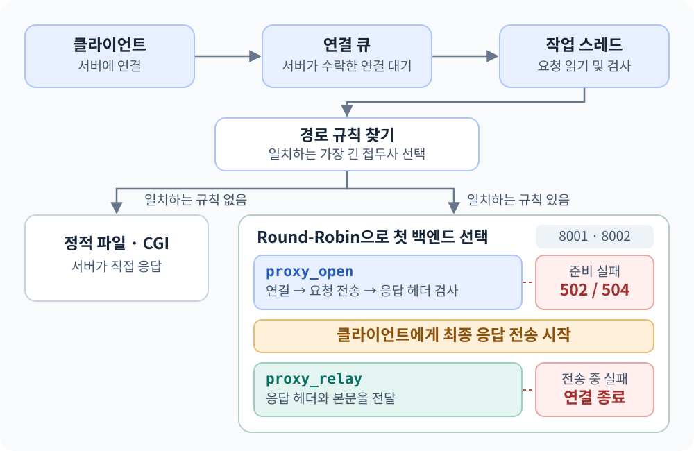
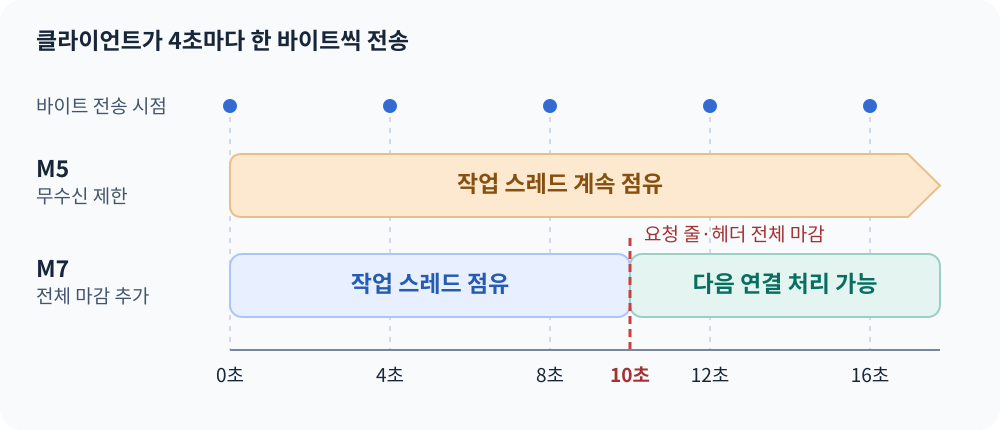
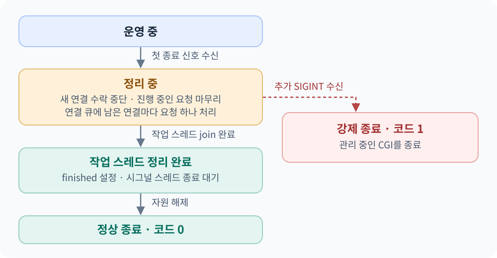

# M6 Reverse Proxy · M7 안정성 PRD (다빈)

구현 기준은 `phase2/base`의 `20782e4`입니다. 작업 브랜치 `phase2/dabin-m6m7`에서 WSL(Ubuntu)의 `make verify`, `make tsan`을 통과했습니다. macOS 검증은 PR CI에서 진행합니다.

- [0. 결정 요약](#0-결정-요약)
- [1. 목표와 범위](#1-목표와-범위)
- [2. M6 Reverse Proxy](#2-m6-reverse-proxy)
- [3. M7 안정성](#3-m7-안정성)
- [4. M4·M5 이슈 처리](#4-m4m5-이슈-처리)
- [5. 검증](#5-검증)
- [6. 한계와 다시 검토할 조건](#6-한계와-다시-검토할-조건)

---

## 0. 결정 요약

- **M6 Reverse Proxy.** 클라이언트 요청의 경로에 맞는 가장 긴 접두사를 찾고, 해당 규칙의 백엔드를 Round-Robin으로 선택합니다(R15). 일치하는 규칙이 없으면 정적 파일이나 CGI를 직접 처리합니다(R16). 백엔드에는 요청마다 HTTP/1.0으로 새로 연결하고, 응답은 헤더를 검사한 뒤 본문을 받은 만큼 전달합니다.
- **M7 안정성.** 클라이언트의 요청 줄·헤더와 본문에 각각 전체 마감을 둡니다. 연결 큐에 대기 중인 연결이 쌓이면 다음 응답에서 keep-alive를 양보합니다. 종료 신호를 받으면 새 연결 수락을 멈추고, 진행 중인 요청과 연결 큐에 남은 연결의 첫 요청을 마칩니다.

팀과 먼저 논의할 내용은 [기존 최종 PRD와의 차이](#42-finalmd와-달라지는-것-팀-확인-필요)와 [회의 안건](#43-팀-회의-안건으로-남긴-것)에 있습니다. 별도로 팀 확인이 필요한 수신 마감(R3)과 메서드 형식 검사(R1)는 해당 절에 표시했습니다. 실행 인자와 시연 절차는 [5.2 직접 확인](#52-직접-확인)에 있습니다.

---

## 1. 목표와 범위

### 완료 기준

| 확인 | 결과 |
| --- | --- |
| 백엔드 2개로 반복 요청 | 로그에 두 백엔드가 번갈아 찍힘 |
| 백엔드를 모두 끄고 요청 | `502` |
| 백엔드가 답하지 않음 | 제한 시간 뒤 `504` |
| 큰 파일을 받던 클라이언트가 연결을 끊음 | 서버가 다음 요청에도 응답함 |
| 서버에 Ctrl+C | 하던 요청을 마치고 종료 코드 0, 누수 보고 없음 |
| 긴 URI, 큰 `Content-Length`, 엉터리 요청 | `414`, `413`, `400` (M5에서 구현, 이번에 다시 확인) |

### 이번 범위 밖

| 항목 | 이유 |
| --- | --- |
| Forward Proxy, 캐싱 | 프록시 하나로 LMS 필수를 채움. `proxy` 모듈이 라우팅을 모르므로 나중에 더할 수 있음 |
| 백엔드 연결 재사용, 상태 확인(health check) | 연결 풀, 확인 스레드, 공유 상태가 늘어남 |
| chunked 해석, Host 기준 라우팅, HTTPS | 과제 필수가 아님 |

---

## 2. M6 Reverse Proxy

### 2.1 구조와 요청 흐름

`/api/`를 백엔드 두 대에 연결한 서버를 예로 듭니다. `GET /api/users`는 프록시가 중계하고, 일치하는 규칙이 없는 `GET /home.html`은 서버가 직접 처리합니다.



경로에 `..` 조각이 있으면 라우팅 전에 `403`으로 응답합니다. `proxy_open`이 최종 응답 헤더를 확인한 뒤 `proxy_relay`가 전송을 시작합니다. 중계가 끝나면 기존 keep-alive 규칙을 적용합니다. 전송 전후의 오류 처리와 재시도 조건은 [2.5 실패했을 때](#25-실패했을-때)에 정리했습니다.

| 파일 | 역할 |
| --- | --- |
| [`src/route.c`](../../src/route.c) | 규칙 해석, 가장 긴 접두사 찾기, 규칙별 Round-Robin 순번 관리 |
| [`src/proxy.c`](../../src/proxy.c) | 백엔드 연결, 요청 재작성, 응답 중계 |
| [`src/main/tiny.c`](../../src/main/tiny.c)의 `proxy_serve` | 라우팅 결과와 중계 로직 연결, `502`·`504` 응답 및 로그 작성 |

### 2.2 라우팅 규칙

| 상황 | 처리 |
| --- | --- |
| 접두사 형식 | `/`로 시작하고 `/`로 끝나야 함. 그래서 `/apix/...`는 `/api/`에 걸리지 않음 |
| 같은 접두사가 두 번 | 시작 오류 |
| 백엔드가 프록시 자신 (로컬 주소와 수신 포트가 모두 일치) | 시작 오류. 한 요청이 프록시로 되돌아오며 작업 스레드를 모두 점유할 수 있음 (RFC 9110 7.6). 같은 컴퓨터의 다른 포트는 허용 |
| 형식 오류, 주소로 바꿀 수 없는 이름 | 시작 오류. 주소는 시작할 때 한 번만 찾음 (IPv4). DNS가 바뀌면 재시작해야 함 |
| 쿼리 안의 접두사 (`/a?/api/`) | 걸리지 않음. 쿼리를 뗀 경로만 봄 |
| `/api` (끝에 `/` 없음) | `/api/` 규칙에 걸리지 않음. 다른 규칙에도 맞지 않으면 정적 파일·CGI로 처리 |
| 경로 | 바꾸지 않고 그대로 보냄 |

### 2.3 백엔드로 보내는 요청

```
수신 요청 (클라이언트 → 프록시)         송신 요청 (프록시 → 백엔드)
GET /api/users?id=1 HTTP/1.1           GET /api/users?id=1 HTTP/1.0
Host: example.com                     Host: example.com
Connection: keep-alive, X-Hop         X-End: 1
X-Hop: 1                              Via: 1.1 tiny
X-End: 1                              Connection: close
```

- 한 구간 전용 헤더(`Connection`, `Proxy-Connection`, `Keep-Alive`, `TE`, `Transfer-Encoding`, `Upgrade`)와 `Connection`에 적힌 헤더를 뺍니다 (RFC 9110 7.6.1).
- **`Host`와 `Content-Length`는 프록시가 직접 씁니다.** 클라이언트 쪽 연결 전용 헤더를 제거한 뒤 검증한 값으로 구성합니다.
- `Expect`는 프록시가 처리하고 백엔드로 전달하지 않습니다.
- `Via`는 프록시가 붙여야 하는 헤더입니다 (RFC 9110 7.6.3).

### 2.4 응답의 끝과 길이 헤더

`final.md` 0장의 "모든 응답에 `Content-Length`"에 **예외가 생깁니다.**

| 백엔드 응답 | 클라이언트에게 보내는 `Content-Length` | 본문 | 클라이언트 연결 |
| --- | --- | --- | --- |
| 길이 있음 | 백엔드 값 | 그 바이트만큼. 더 온 것은 버림 | 유지 |
| 길이 없음 | 없음 | 백엔드가 닫을 때까지 | `close` |
| HEAD, `304` | 백엔드가 준 값만. 없으면 만들지 않음 | 없음 | 유지 |
| `204` | 없음 (RFC 9110 8.6) | 없음 | 유지 |
| `100`, `103` | 전달하지 않고 다음 응답을 읽음 | | |
| `Transfer-Encoding`, `101`, 형식 오류, 서로 다른 길이, 헤더 8 KiB 초과 | `502` | | 유지 |

`Transfer-Encoding`은 HTTP/1.0 요청에 올 수 없으므로 상태 코드와 상관없이 `502`입니다.

### 2.5 실패했을 때

| 시점 | 실패 원인 | 응답 | 클라이언트 연결 |
| --- | --- | --- | --- |
| 연결 전 | 거부됨, 도달 불가 등 연결하지 못함 | 다음 백엔드 시도. 모두 실패하면 `502` | 유지 |
| 연결 전 | 프록시가 소켓을 열지 못함 (fd 부족) | 바로 `502` | 유지 |
| 최종 응답 전송 전 | 시간 초과 (프록시 마감, 운영체제의 `ETIMEDOUT`) | `504`. 연결 중이어도 다음 백엔드를 시도하지 않음 | 유지 |
| 최종 응답 전송 전 | 연결이 끊기거나 응답 형식이 잘못됨 | `502`. **요청을 다시 보내지 않음** | 유지 |
| 전달하는 중 | 본문 길이 부족, 무수신, 클라이언트 연결 끊김 | 없음 (로그에 `(중단)`) | 바로 닫음 |
| 전달하는 중 | **길이가 없는데** 백엔드 오류나 무수신 | 없음 (로그에 `(중단)`) | **RST로 닫음** |

두 표에서 **유지**는 기존 keep-alive 조건을 충족할 때 연결을 유지한다는 뜻입니다.

**RST로 닫는 이유:** 길이가 없는 응답은 FIN을 받으면 끝난 것으로 봅니다. 중간에 실패한 응답을 FIN으로 닫으면 클라이언트가 성공으로 처리할 수 있습니다. 아래는 curl로 확인한 결과입니다.

| 응답 | FIN | RST | `shutdown(SHUT_WR)` 뒤 RST |
| --- | --- | --- | --- |
| `Content-Length` 있음, 중간에 끊김 | 오류 18 | 오류 56 | |
| 길이 없음, 중간에 끊김 | **성공(0)** | 오류 56 | **성공(0)** |

그래서 RST로 닫을 때는 비우기(`connection_close_lingering`)를 하지 않습니다.

### 2.6 시간 제한

```
백엔드  |◀── 연결 · 요청 전송 · 최종 응답 헤더 (합계 10초) ──▶|◀ 본문: 무수신 10초 ▶|
```

- 다음 백엔드로 넘어가거나 `100`, `103`을 버리고 다시 읽어도 처음 잡은 마감 시각을 씁니다.
- 연결 거부와 도달 불가는 백엔드에 요청 바이트를 보내기 전에 발생하므로 다음 후보를 시도할 수 있습니다. `socket()` 실패와 시간 초과의 처리는 [2.5](#25-실패했을-때)를 따릅니다.
- 본문의 무수신 시간은 바이트를 읽을 때마다 다시 셉니다. 클라이언트에게 쓰는 시간은 이 계산에서 뺍니다.
- blocking `connect`는 꺼진 컴퓨터를 만나면 1분 넘게 멈출 수 있어, non-blocking `connect`와 `poll`을 씁니다. `SO_SNDTIMEO`는 macOS의 `connect`에 적용된다고 볼 수 없어 쓰지 않았습니다.

### 2.7 검토한 다른 방법

| 결정 | 다른 방법 | 고르지 않은 이유 |
| --- | --- | --- |
| Reverse | Forward | HTTPS(`CONNECT`)가 안 돼 실제 사이트 대부분에 못 쓰고, 내부망 주소로 가는 요청을 따로 막아야 함 |
| | 둘 다 | 절대 URI 해석과 이름 찾기까지 테스트 범위가 커짐 |
| CLI 인자 | 설정 파일 | 파일 파서와 줄 번호 오류 처리가 필요함. 규칙 해석이 `route_table_add` 하나에 있어 나중에 파일의 줄마다 부르면 됨 |
| 경로 접두사 | Host | 포트와 대소문자 처리가 필요하고, 시험할 때 헤더를 바꿔야 함 |
| 바로 전달 | 1 MiB까지 모은 뒤 전송 | 1 MiB를 넘는 파일이 `502`가 됨 |
| HTTP/1.0 | HTTP/1.1 + `close` | chunked 해석이 필요함 |
| | HTTP/1.1 연결 재사용 | 연결 풀, 락, 끊긴 연결 재시도가 필요함 |
| 연결하지 못한 경우만 재시도 | 재시도 없음 | 살아 있는 백엔드가 있어도 요청 절반이 실패함 |
| | 주기적 상태 확인 | 확인 스레드와 공유 상태가 필요함 |

---

## 3. M7 안정성

### 3.1 클라이언트 요청의 수신 제한



기본값은 첫 바이트 대기 **5초**, 첫 바이트 이후 요청 줄·헤더 전체 **10초**, 본문 전체 **30초**입니다. 요청 줄·헤더와 본문을 읽는 중에도 5초 동안 새 바이트가 오지 않으면 연결을 닫습니다. 전체 마감은 바이트가 추가로 와도 연장하지 않습니다. **[팀 확인 필요 · R3]**

| 상황 | 이전 | 지금 |
| --- | --- | --- |
| 첫 바이트가 도착하지 않음 | 5초 | 5초 |
| 요청을 보내다 멈춤 | 5초 | 5초 |
| 무수신 제한보다 짧은 간격으로 계속 보냄 | 전체 마감 없음 | 요청 줄·헤더 10초, 본문 30초 |
| keep-alive로 요청을 반복함 | 연결당 최대 100건 | 연결당 최대 100건. 연결 큐가 밀리면 다음 응답 뒤 닫음 |

- **마감 확인 위치.** `rio_readlineb`가 한 줄을 읽는 중에도 제한을 적용하도록 `rio_t`에 마감 시각을 둡니다. `rio_read`가 소켓을 읽기 전에 `poll`로 남은 시간과 무수신 제한 중 짧은 시간만 기다립니다.
- **본문 마감 시작.** 헤더 검사를 마치고, 필요한 경우 `100 Continue`를 보낸 뒤 본문을 읽는 시점부터 셉니다.
- **다음 요청 대기.** 클라이언트가 다음 요청을 미리 보내면 `rio` 버퍼에 이미 데이터가 있을 수 있습니다. 소켓을 기다리기 전에 버퍼를 확인합니다.

**keep-alive 양보(D8).** 응답 헤더를 쓰기 직전에 연결 큐의 대기 연결 수와 유휴 작업 스레드 수를 비교합니다. 대기 연결 수가 더 많으면 `Connection: close`로 응답해 다음 연결에 작업 스레드를 내줍니다.

> M8에서 동시 연결 수가 작업 스레드 16개를 넘으면 이 정책이 keep-alive 재사용률과 처리량에 영향을 줄 수 있습니다.

### 3.2 안전한 종료

`final.md` 2.7에 따라 시그널 전용 스레드가 `sigwait`로 첫 `SIGINT`, `SIGTERM` 또는 `SIGHUP`을 기다립니다. `nohup`으로 실행해 `SIGHUP`이 처음부터 무시 상태면 그 설정을 유지합니다.



시그널 스레드는 종료 상태로 전환한 뒤 대기 중인 스레드를 깨웁니다. 메인 스레드는 연결 큐에 넣지 못한 연결과 리스닝 소켓을 닫습니다. 응답 중인 작업 스레드는 가능한 경우 `Connection: close`를 보냅니다.

| 대기 위치 | 깨우는 방법 |
| --- | --- |
| 메인 스레드 또는 유휴 keep-alive 연결이 `poll`에서 대기 | 종료 알림 pipe에 1바이트 쓰기 |
| 메인 스레드가 가득 찬 연결 큐에서 대기하거나 작업 스레드가 빈 연결 큐에서 대기 | `conn_queue_shutdown()`이 조건 변수로 알림 |

| 규칙 | 이유 |
| --- | --- |
| pipe에 쓴 바이트는 읽지 않음 | 같은 pipe를 확인하는 모든 스레드가 종료 알림을 받을 수 있도록 읽기 가능 상태를 유지 |
| 리스닝 소켓은 논블로킹 | `poll` 뒤 `accept` 전에 클라이언트가 끊어도 메인 스레드가 멈추지 않음. macOS에서 이 설정을 물려받은 접속 소켓은 블로킹으로 되돌림 |
| 두 번째 요청부터 종료 알림도 함께 기다림 | 연결 큐에 이미 들어온 연결의 첫 요청은 처리 |
| 소켓과 알림이 함께 준비되면 소켓이 먼저 | 이미 도착한 요청을 두고 닫으면 RST가 나갈 수 있음 |
| 정리 중 추가 `SIGINT`만 강제 종료 | `SIGTERM`이나 `SIGHUP`이 더 도착해도 정상 종료 절차를 계속 진행 |
| 시그널 스레드까지 끝낸 뒤 자원 해제 | 메인 스레드는 작업 스레드가 모두 끝나면 `finished`를 설정하고, `pthread_kill`로 시그널 스레드를 깨워 join함. 이 순서로 해제된 CGI 목록에 시그널 스레드가 접근하는 문제를 방지함(ASan으로 확인) |

**정상 종료 시간에는 전체 상한이 없습니다.** 아무 데이터도 보내지 않는 연결이 작업 스레드 16개와 연결 큐 64개를 모두 채우면 약 25초, 모두 10초가 걸리는 CGI 요청이면 50초 이상이 걸릴 수 있습니다(계산값). 응답을 천천히 읽는 클라이언트도 종료를 늦출 수 있습니다. 운영체제의 연결 대기열(backlog)에만 있던 연결은 응답 없이 끊깁니다.

### 3.3 CGI 프로세스

| 설정 | 이유 |
| --- | --- |
| 자기 프로세스 그룹 (`setpgid`) | 터미널의 Ctrl+C가 CGI에 직접 전달되면 실행 중인 요청이 중단되고 클라이언트는 `500`을 받음. 그룹을 분리해 첫 Ctrl+C 뒤에도 요청을 마무리 |
| 시그널 차단 해제 | `execve` 뒤에도 남아 CGI가 SIGTERM에 죽지 않음 |
| SIGPIPE를 기본 동작으로 (C6) | 서버의 무시 설정도 `execve` 뒤에 남음 |
| 실행 중인 pid 목록 | 강제 종료 때 남기지 않기 위함 |

- `fork`와 목록 적기, `waitpid`와 목록 지우기는 각각 한 락 안에서 합니다. 앞은 목록에 없는 CGI가 남는 것을, 뒤는 재사용된 pid를 죽이는 것을 막습니다.
- **정리 범위:** 강제 종료 때와, 서버가 CGI를 중단할 때(시간 초과, 출력 1 MiB 초과, 읽기 오류)에 **아직 회수하지 않은** CGI의 그룹을 정리합니다. 스스로 끝난 CGI가 남긴 자식은 정리하지 않습니다.
- **`kill`은 그룹과 CGI 자신 양쪽에 보냅니다.** CGI가 다른 그룹으로 옮겨 가면 그룹에 보낸 시그널이 닿지 않습니다. 끝나기를 기다리는 동안에는 락을 풀어 다른 CGI를 막지 않습니다.

### 3.4 검토한 다른 방법

| 결정 | 다른 방법 | 고르지 않은 이유 |
| --- | --- | --- |
| 연결 큐까지 처리 | 진행 중인 요청만 처리 | 연결 큐에 이미 들어온 클라이언트 연결이 응답 없이 끊김 |
| | 전체 마감 시간 | 실행 중인 연결 목록과 강제 끊기가 필요함. 두 번째 Ctrl+C로 대신함 |
| CGI kill | `PR_SET_PDEATHSIG` | Linux에만 있음 |
| `rio`에 마감 | 감시 스레드 | 연결 목록과 락, fd 재사용 문제가 생김 |
| keep-alive 양보 | 유휴 연결을 작업 스레드에서 분리 | 이벤트 루프가 필요함 |
| 비우기 1초 유지 | 읽지 못한 오류에만 | 양보(D8) 때문에 서버가 먼저 닫는 일이 늘어, 미리 보낸 요청이 있으면 응답을 잃을 수 있음 |

---

## 4. M4·M5 이슈 처리

M6·M7 설계 결정과 별개로, 중간 점검에서 나온 문제입니다. 커밋도 나눴습니다.

### 4.1 고친 것

| ID | 문제 | 처리 |
| --- | --- | --- |
| C1·D1 | 루트 밖 파일 읽기·실행 | URI가 `/`로 시작하지 않으면 `400` |
| A1·D2 | NUL 뒤를 못 봄 | 요청 줄과 헤더 줄에 탭이 아닌 ASCII 제어 문자가 있으면 `400`. NUL과 줄 중간의 CR을 거절해 프록시와 백엔드가 헤더 경계를 동일하게 해석하도록 함 |
| - | 헤더 이름의 문자 | HTTP 토큰에 허용된 문자만 받음. 클라이언트 요청은 `400`, 백엔드 응답은 `502`, CGI 출력은 `500` |
| T3 | Host 형식 | 아래 형식이 아니면 `400` (RFC 9112 3.2). 빈 값과 `:80`처럼 이름이 빈 값도 `400` (RFC 9110 4.2.1). HTTP/1.0에서 Host가 없는 요청은 받음 |
| B1·D3 | keep-alive 요청마다 약 44ms | `TCP_NODELAY`. 헤더와 본문을 한 번에 쓰는 방법은 세 곳을 고쳐야 하고 프록시의 바로 전달에 맞지 않음 |
| C2·C3·D5 | 쿼리와 `cgi-bin` 판정 | 4.2 참고 |
| B2·D4 | CGI 응답을 그대로 전달 | 한 구간 전용 헤더 제거, `Transfer-Encoding`과 `1xx`는 `500`, `204`·`304`는 본문과 길이 없음 |
| A2·T2 | `adder` 범위 | 입력과 합이 `int` 범위면 계산 |
| A5 | 전송 실패 뒤 비우기 | 바로 닫음. 실측 6.85초 → 5.86초 |
| D8·R3·C6 | 작업 스레드 독점, Slowloris, SIGPIPE | 3장 |
| A3·A4·C4·C5 | `errno`, PATH, 포트, HTML 글자 | `perror` 전에 저장 / 길이만큼 할당 / 1~65535만 / `<>&"` 변환 |
| R1 | 잘못된 메서드 글자 **[팀 확인 필요]** | `G@T`는 `400`, 형식이 맞는 모르는 메서드는 `501` |
| Q1·Q2·I3 | 누수 검사, CGI 실행 중 재시작 | 테스트 추가 |

**지원하는 Host 형식:** `이름[:포트]`(이름은 RFC 3986의 reg-name 글자, `%`는 뒤에 16진수 두 자리), `[IPv6][:포트]`(`inet_pton`으로 확인). IPvFuture(`[v1.x]`)는 받지 않습니다. 처음에는 글자만 보고 빈 값을 허용하기로 했다가, RFC의 MUST에 맞추려고 바꿨습니다.

C1과 A1은 `phase2/bloro`에 있는 규칙을 포함합니다(제어 문자 전체를 거절하는 것은 더 엄격함). 그 브랜치는 M4·M5를 따로 구현해 cherry-pick할 수 없어 규칙만 옮겼습니다.

### 4.2 `final.md`와 달라지는 것 [팀 확인 필요]

| `final.md` | 지금 |
| --- | --- |
| 0장: 모든 응답에 `Content-Length` | `204`, `304`, 길이 헤더를 주지 않은 HEAD, 길이를 모르는 프록시 응답은 예외 (2.4) |
| 1장, 3.2: Host를 M6에서 라우팅에 씀 | 경로 접두사로 라우팅. Host는 검사하고 백엔드로 전달만 함 |
| 4.4: CGI 헤더를 그대로 전달 | 한 구간 전용 헤더는 빼고 `Transfer-Encoding`은 `500`. 헤더만 떼면 CGI가 나눠 쓴 chunk 표시가 본문에 섞임 |
| 4.4: CGI 헤더 이름에 공백이 있어도 `200` | `500`. token이 아닌 이름과 제어 문자가 든 값을 거절 |
| Host가 비어 있어도 `200` | `400` |
| 5.2: `501`이면 닫음 | 정적 POST의 `501`은 요청을 다 읽었으므로 유지 (원래 동작, 표만 다름) |
| 주소 어디에든 `cgi-bin`이 있으면 CGI | **첫 조각이 `cgi-bin`일 때만** CGI. `/a/cgi-bin/x`는 정적 파일이 됨 |
| `//style.css`, `/./style.css`는 `200` | `403`. 허용하면 `//cgi-bin/adder`로 프로그램 파일이 내려감 |
| `/style.css?v=1`은 `404` | `200` |

경로 규칙은 URL 표기를 검사합니다. 루트 안의 심볼릭 링크가 어디를 가리키는지는 막지 않습니다.

### 4.3 팀 회의 안건으로 남긴 것

| ID | 안건 | 이 브랜치의 상태 |
| --- | --- | --- |
| R0 | `414`, `505`를 합의로 기록할지 | 코드 유지 |
| R2 | 정적 POST를 `405` + `Allow`로 바꿀지 | `501` 유지. 팀 계획의 확인 명령과 기준선 테스트가 `501` |
| - | `HTTP/1.2`를 `505`로 둘지 | `505` 유지. RFC 9110은 1.1처럼 처리하라고 권함 |
| I1 | M8 비교용 연결당 스레드 | 없음. `phase2/bloro`의 `0c89b54`를 쓸 수 있음 |
| I2 | M5-4a·4b 구분 | 없음 |
| Q3 | `tiny.c`, `adder.c` lint, 영어 테스트 이름 | 그대로. 새 파일만 규칙을 지킴 |

### 4.4 기록만 하는 것

- **D10:** 응답을 보내고 닫을 때 `shutdown(SHUT_WR)` 뒤 최대 1초 동안 남은 데이터를 읽어 버립니다. 바로 닫으면 커널이 RST를 보내 오류 응답이 사라질 수 있습니다(macOS CI의 `414`).
- **T1:** 쓰기 제한 10초는 `write` 호출 한 번에 적용됩니다. 클라이언트가 응답을 조금씩 받아 가면 전체 전송은 10초보다 길어질 수 있습니다.

---

## 5. 검증

### 5.1 자동 테스트

| 파일 | 확인하는 것 |
| --- | --- |
| `tests/http_test.c` | 요청 검사, 헤더 거르기 |
| `tests/route_test.c` | 규칙 해석, 가장 긴 접두사, 여러 스레드의 Round-Robin |
| `tests/proxy_test.c` | 요청 다시 쓰기, 응답 해석, 전달과 중단 |
| `tests/functional/issues_test.py` | 4.1의 이슈 회귀 |
| `tests/functional/proxy_test.py` | 2장 전체. 백엔드를 테스트 안에 띄워 늦은 응답, 잘린 응답, 잘못된 응답을 만듦 |
| `tests/functional/stability_test.py` | 요청 마감, keep-alive 양보 |
| `tests/functional/shutdown_test.py` | 종료, 강제 종료, CGI 프로세스, 누수 |

- **테스트가 실제로 잡는지 확인:** 코드를 29군데 일부러 망가뜨려(RST 생략, 재시도 생략, 종료 알림 생략, `free` 생략, 마감 생략, 파이프라이닝 버퍼 무시, 시그널 스레드를 남겨 둠 등) 모두 테스트가 실패하는 것을 확인했습니다. "정리가 끝난 뒤의 SIGINT" 테스트는 시점을 맞추기 어려워 고치기 전 코드에서도 통과했고, 그 오류는 "SIGINT를 연달아 보내도" 테스트가 잡습니다.
- **새 기능 테스트는 서버를 끌 때마다 종료 코드와 로그를 확인합니다** (`tests/functional/checked_server.py`). 누수나 메모리 오류가 나면 그 테스트가 실패합니다.
- **서버 전체 TSan.** `tiny`를 ThreadSanitizer로 따로 빌드해 프록시·종료·안정성 기능 테스트를 실행했고, 데이터 경합 보고는 없었습니다. 강제 종료 때 join하지 않은 작업 스레드에 대한 thread leak 보고가 1건 있었습니다.
- **누수 검사:** 실패하는 요청들을 먼저 보낸 뒤 SIGTERM으로 끄고, 종료 코드 0과 로그를 확인합니다. 5초 안에 끝나지 않으면 실패입니다. 누수 판정은 Linux에서만 됩니다.
- **재시작:** CGI가 실행 중인 것을 확인하고 서버에만 SIGKILL을 보낸 뒤, CGI가 살아 있는 동안 새 서버가 같은 포트에서 응답하는지 봅니다. 확인하는 것은 리스닝 소켓 상속 차단입니다.

### 5.2 직접 확인

#### 실행 인자

```text
./build/tiny <port> [--root DIR] [--threads N] [--queue N] [--timeout 초] [--keepalive-max N]
                    [--proxy /접두사/=이름:포트,이름:포트]... [--proxy-timeout 초]
```

| 인자 | 기본값 | 적용 범위 |
| --- | --- | --- |
| `--proxy` | 없음 | 반복 지정 가능. 규칙 최대 16개, 규칙당 백엔드 최대 8개 |
| `--proxy-timeout` | 10초 | 백엔드 연결부터 최종 응답 헤더까지의 합계 제한과 본문 무수신 제한 |
| `<port>` | 필수 | 1~65535 범위의 숫자 (C4) |

나머지 인자와 기본값은 `final.md`를 따릅니다. 요청 줄·헤더 마감과 본문 마감은 각각 `--timeout`의 2배와 6배입니다.

#### 두 백엔드로 시연

```bash
make
mkdir -p /tmp/b1/api /tmp/b2/api && echo one > /tmp/b1/api/x && echo two > /tmp/b2/api/x
python3 -m http.server 8001 -d /tmp/b1 &
python3 -m http.server 8002 -d /tmp/b2 &
./build/tiny 8000 --root tests/fixtures/www --proxy /api/=127.0.0.1:8001,127.0.0.1:8002
```

| 명령 | 결과 |
| --- | --- |
| `curl localhost:8000/api/x` 반복 | `one`, `two`가 번갈아 나오고 로그에 `-> 127.0.0.1:8001`, `-> 127.0.0.1:8002` |
| `curl -i localhost:8000/home.html` | 백엔드를 거치지 않고 `200` |
| 8001만 끄고 반복 | 모두 `two` |
| 둘 다 끄고 `curl -i localhost:8000/api/x` | `502` |
| 서버 터미널에서 Ctrl+C | `종료 시작`, `종료 완료`, 종료 코드 0 |

---

## 6. 한계와 다시 검토할 조건

| 한계 | 영향 | 다시 검토할 조건 |
| --- | --- | --- |
| 백엔드 **프로세스가 죽으면** 길이 없는 응답은 완성으로 보임 | 커널이 정상 FIN을 보내 구분할 수 없음 (`kill -9`로 확인) | 길이를 주지 않는 백엔드를 실제로 쓸 때 |
| 끊어진 클라이언트 연결을 즉시 확인하지 못함 (D9) | CGI와 백엔드 헤더는 기본 10초까지 대기. 본문 중계 중에는 다음 쓰기까지 연결 끊김을 감지하지 못할 수 있으며, 중계 전체에는 시간 상한이 없음 | 작업 스레드 부족이 측정되면 |
| 클라이언트가 응답을 천천히 읽음 (T1) | 작업 스레드 점유와 정상 종료가 길어질 수 있음 | 응답 전체 마감이 필요해지면 |
| 꺼진 백엔드에 매번 연결해 봄 | 응답 없는 주소면 제한 시간을 모두 써 `504` | 백엔드가 자주 꺼지면 상태 확인 추가 |
| 요청을 보내는 중에 먼저 응답한 백엔드 | 요청 전송이 실패하면 응답을 읽지 않고 `502` | 큰 본문을 일찍 거절하는 백엔드를 쓸 때 |
| GET, POST, HEAD만 중계 | PUT, DELETE를 쓰는 API는 `501` | 그런 백엔드를 붙일 때 |
| chunked 미지원 | chunked 요청은 `501`, chunked 응답은 `502` | `final.md` 10장과 같음 |
| 절대 URI `400` (D6) | RFC 9112는 일반 서버도 받으라고 함 | Forward Proxy를 만들 때 |
| 요청마다 새 연결이라 `TIME_WAIT`가 쌓임 | 출발지 IP 하나, 백엔드 주소·포트 하나, `TIME_WAIT` 60초, 포트 재사용 없음을 가정하면 초당 약 470건(28,000개 ÷ 60초, 계산값). 로컬 20초 부하에서는 초당 32,002건, 실패 없음(로컬은 포트를 빨리 다시 씀) | M8에서 원격 백엔드로 실제 한계를 측정 |
| 다른 프록시를 거쳐 되돌아오는 간접 루프 | 작업 스레드를 점유함. 프록시 자신을 백엔드로 직접 지정하는 설정은 시작할 때 거절 | 프록시를 여러 단계로 쓸 때 |
| DNS 변경 | 시작할 때만 주소를 찾으므로 재시작해야 반영 | 백엔드 주소가 자주 바뀔 때 |
| 스스로 끝난 CGI가 남긴 자식 | 강제 종료 때도 남음 | CGI가 백그라운드 작업을 남길 때 |
| `%` 해석, CGI `Location` (D7) | `/%63gi-bin/`은 글자 그대로 찾음. 백엔드로 가는 `%2e%2e`는 막지 않음 | 완료 기준에 들어올 때 |
| `X-Forwarded-For` 없음 | 백엔드가 클라이언트의 IP를 모름 | 백엔드 로그에 필요해지면 |
| 심볼릭 링크 | 루트 안의 링크가 밖을 가리키면 따라감 | 믿을 수 없는 파일을 루트에 둘 때 |
