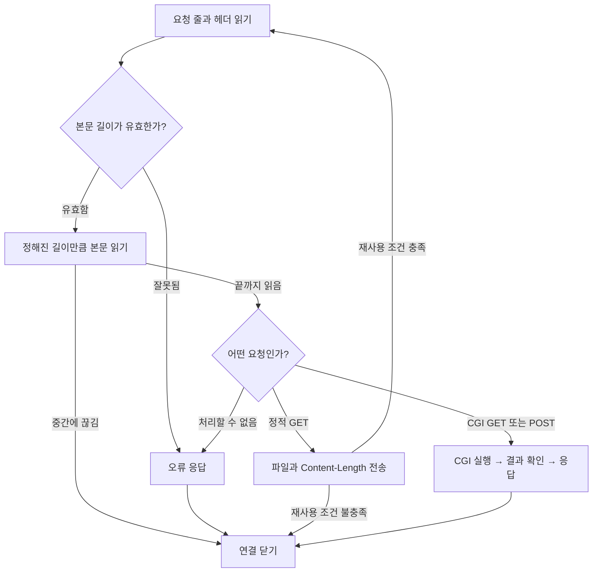
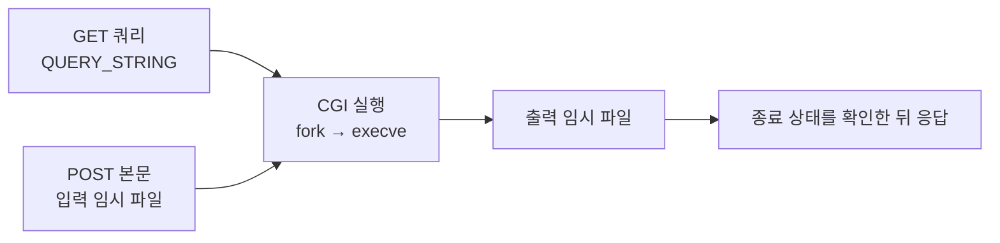

# 다빈 개인 PRD · M4 동시성, M5 HTTP 완성

| 팀 구현 계획 | 설계 제안 | 완료 기준 |
| --- | --- | --- |
| M4 · 여러 연결 동시 처리 | **스레드 풀** · 작업자 16개, 작업 큐 64칸 | A가 접속만 하고 있어도 B는 파일을 바로 받습니다. |
| M5 · 헤더, POST, 연결 재사용 | 본문 길이를 확인해 CGI에서 처리. **성공한 정적 GET만 연결 재사용** | POST로 보낸 두 수를 더하고, 같은 연결에서 정적 GET 두 건을 처리합니다. |

## M4 · 누가 연결을 맡나

- **왜 스레드 풀인가** · 작업자 수를 고정하면서 기존의 요청 읽기 → 처리 → 응답 순서를 유지합니다. LMS가 pthread를 쓸 때 권장하는 방식입니다.
- 연결마다 스레드나 프로세스를 만들면 접속이 늘 때마다 실행 단위가 늘어납니다. 이벤트 루프는 조용한 연결이 작업자를 차지하는 문제를 줄이지만, 연결별로 어디까지 읽고 보냈는지 관리해야 합니다.

### 큐가 비거나 가득 차면

| 큐 상태 | 누가 기다리나 | 언제 깨어나나 |
| --- | --- | --- |
| 비어 있음 | 작업자가 `not_empty`를 기다립니다. | 메인이 연결을 넣었을 때 |
| 가득 참 | 메인이 방금 받은 연결 하나를 들고 `not_full`을 기다립니다. | 작업자가 연결 하나를 꺼냈을 때 |

- 큐에는 한 번에 한 스레드만 들어가도록 `mutex`로 잠급니다. 기다릴 때는 락을 풀고, 깨어나면 다시 잡아 큐 상태를 확인합니다.
- 메인이 기다리는 동안 새 연결은 운영체제 대기열에 자리가 있으면 거기서 기다립니다. 작업 큐는 64칸으로 유지합니다.

### 작업자가 오래 기다리면

| 기다리는 곳 | 제한 | 한계 |
| --- | --- | --- |
| 요청 읽기 | 소켓 읽기 대기 **5초** | 조금씩 보내면 요청 전체는 더 오래 걸릴 수 있습니다. |
| 응답 쓰기 | 소켓 쓰기 대기 **10초** | 일부를 보낸 뒤 다음 쓰기에서 다시 기다릴 수 있습니다. |
| CGI 종료 | 자식에서 `alarm(10)` | CGI가 타이머를 취소하거나 신호를 무시하면 더 기다릴 수 있습니다. |

WSL 실험에서 작업자 16개를 채운 뒤 새 정적 GET을 보냈습니다.

| 작업자를 채운 상황 | 제한 없이 기다렸을 때 | 제한을 적용했을 때 |
| --- | --- | --- |
| 아무것도 보내지 않는 연결 | 9초간 응답 없음 | 4.89초 뒤 `200` |
| 다운로드를 멈춘 연결 | 45초간 응답 없음 | 29.5초 뒤 `200` |
| 끝나지 않는 CGI | 45초간 응답 없음 | 9초 뒤 `200` |

### M4 결정과 이유

- 중요도는 합의 순서입니다. 규모는 Phase 1에서 바뀌는 범위입니다.
- 규모는 여러 단계가 바뀌면 큼, 한 기능의 흐름이 바뀌면 보통, 값이나 조건 몇 줄이면 작음으로 봅니다.

| 결정 | 중요도 · 규모 | 이유 |
| --- | --- | --- |
| 스레드 풀 | 상 · 큼 | 연결을 받는 일과 요청을 처리하는 일을 나눕니다. |
| 읽기 5초 · 쓰기 10초 · CGI 10초 | 상 · 각각 작음 | 작업자가 같은 연결이나 CGI를 계속 기다리는 상황을 줄입니다. |
| 작업자 16개 · 큐 64칸 | 중 · 보통 | 처리 중인 연결과 대기 중인 연결에 각각 한도를 둡니다. 시작값은 M8 측정에서 다시 봅니다. |
| mutex 1개 · 조건 변수 2개 | 중 · 보통 | 큐를 보호하고 작업자와 메인의 대기 조건을 구분합니다. macOS와 Linux에서 같이 쓸 수 있습니다. |
| `fork()` 전에 CGI 환경 준비 | 상 · 작음 | 자식이 `setenv()`에서 다른 스레드의 락을 기다릴 수 있으므로, 작업자가 필요한 값만 미리 준비합니다. |
| 접속·리스닝 소켓에 `FD_CLOEXEC` | 중 · 작음 | CGI가 실행되면 자식 쪽 소켓을 닫습니다. 이전 CGI가 리스닝 소켓을 계속 들고 있어 재시작이 막히는 일을 피합니다. |
| 작업 큐만 `queue.c/h`로 분리 | 하 · 작음 | 연결 처리 흐름은 한곳에 두고, 큐 공유는 단위 테스트와 `make tsan`으로 확인합니다. |

- 접속 소켓을 받은 직후부터 `FD_CLOEXEC`를 붙이기 전까지는 다른 작업자가 `fork()`할 수 있는 짧은 틈이 있습니다.

## M5 · 요청을 어디까지 읽고, 언제 연결을 다시 쓰나

### 본문 길이

- `POST /cgi-bin/adder`의 본문이 `a=1&b=2`라면 빈 줄 다음 **7바이트**가 본문입니다.
- 서버는 헤더를 읽던 버퍼 `rio`에서 이어서 읽습니다. 다음 요청의 일부도 미리 들어올 수 있어 연결 하나에 버퍼 하나를 씁니다.

| 받은 요청 | 서버 동작 |
| --- | --- |
| 길이가 음수·숫자 아님, 서로 다른 길이가 반복됨, 또는 `Content-Length`와 `Transfer-Encoding`이 함께 옴 | `400` 후 닫기 |
| `Transfer-Encoding`이 잘못됐거나 마지막 방식이 `chunked`가 아님 | `400` 후 닫기 |
| 유효한 `Transfer-Encoding: chunked`만 옴 | 조각 단위 본문은 이번 범위 밖. `501` 후 닫기 |
| `Content-Length: 1048577` | 1MiB 초과. 메모리를 잡기 전에 `413` 후 닫기 |
| 8바이트를 보낸다고 했는데 5바이트만 온 뒤 끊기거나 읽기 제한에 걸림 | 요청을 처리하지 않고 닫기 |
| 길이와 전송 방식 헤더가 모두 없음 | 본문 0바이트. 빈 POST도 같은 규칙 적용 |

- 본문을 읽기 전에 판단하는 `400`과 `413`은 M7에서 M5로 앞당깁니다. 손님이 그때도 본문을 보내고 있으면 오류 응답을 받기 전에 연결이 끊길 수 있습니다. [HTTP 본문 길이 규칙](https://www.rfc-editor.org/rfc/rfc9112.html#section-6.3)

### 연결 재사용

| 상황 | 연결 |
| --- | --- |
| 본문 없는 정적 GET에 `Content-Length`가 있는 `200`을 끝까지 보냄 | HTTP/1.1은 유지. HTTP/1.0은 `Connection: keep-alive`가 있을 때 유지 |
| `Connection`에 `close`가 있음. CGI·오류 응답이나 본문이 붙은 GET도 포함 | 응답 뒤 닫기 |
| 응답을 보내다 실패함 | 바로 닫기 |
| 같은 연결에서 100번째 응답 | `Connection: close`를 넣고 응답 뒤 닫기 |

- 정적 GET만 재사용하면 규칙이 단순합니다. 최대 **100건**을 처리한 작업자는 큐로 돌아가 다음 연결을 맡을 수 있습니다. [HTTP 연결 유지 규칙](https://www.rfc-editor.org/rfc/rfc9112.html#section-9.3)

### CGI가 끝난 뒤 응답

| | 응답을 보내는 순서 |
| --- | --- |
| Phase 1 | `200` 먼저 전송 → CGI 실행 → CGI가 소켓에 직접 출력 |
| M5 제안 | CGI 실행 → 출력 파일에 기록 → 종료 확인 → **상태 코드와 결과 전송** |

- M4 작업자가 CGI 요청을 맡으면 `fork()`로 자식을 만듭니다. 자식은 입출력을 연결한 뒤 `execve()`로 `adder`를 실행합니다.
- POST는 `REQUEST_METHOD`와 `CONTENT_LENGTH`도 넘깁니다. 작업자가 입력 파일을 처음으로 돌려 놓으면 CGI가 첫 바이트부터 읽습니다.
- 임시 파일을 쓰면 CGI가 입력을 안 읽어 작업자가 가득 찬 파이프에 쓰다가 기다리는 경우를 피할 수 있습니다. WSL의 1MiB 입력 실험에서 중간값은 파이프 2.1~2.7ms, 임시 파일 1.9ms였습니다. 실험의 `/tmp`는 메모리에 있었습니다.

| CGI 결과 | 응답 |
| --- | --- |
| 정상 종료하고 출력에서 헤더 끝을 찾음 | `200`과 결과 |
| 임시 파일 준비·저장 실패, CGI 실행·종료 실패, 잘못된 출력 | `500` |
| 10초 제한으로 종료 | `504` 제안 |

- CGI 응답에는 `Connection: close`를 보냅니다. 작업자는 사용한 임시 파일도 닫습니다.

### M5 결정과 이유

| 결정 | 중요도 · 규모 | 이유 |
| --- | --- | --- |
| `Content-Length`로 본문 읽기 | 상 · 보통 | 현재 요청의 끝을 알아야 다음 요청을 찾을 수 있습니다. |
| 정적 GET 성공 응답만 재사용 | 상 · 보통 | 재사용 여부를 확인할 경우를 줄입니다. |
| CGI 입력·출력에 임시 파일 | 상 · 큼 | 실행 결과를 확인한 뒤 상태 코드를 정합니다. |
| 본문 1MiB · 연결당 100건 | 중 · 작음 | 16개 작업자의 본문 버퍼 합계는 최대 16MiB입니다. 연결당 상한으로 한 연결이 작업자를 계속 차지하는 상황을 줄입니다. |
| `Host` · `Content-Length` · `Connection` 저장 | 중 · 보통 | 팀 계획의 세 헤더를 처리합니다. `Transfer-Encoding`은 거절할 때 확인합니다. |
| 헤더 해석·MIME 판별을 `http.c/h`에 둠 | 하 · 작음 | 소켓 없이 테스트할 부분만 뺍니다. 마지막 확장자를 비교해 `.json`과 `.js`를 구분합니다. |
| `adder`에 POST 추가 | 하 · 작음 | GET 쿼리와 POST 본문으로 같은 계산을 확인합니다. 숫자 형식이 틀리거나 입력값 또는 합이 범위를 벗어나면 안내합니다. |

- HTTP/1.1에서 `Host`가 빠지거나, `Host`가 중복되거나 잘못된 경우 `400`을 보냅니다. HTTP/1.0은 `Host`가 없어도 받습니다.
- HEAD는 `501`입니다. `Expect: 100-continue`에 중간 응답을 보내는 기능은 미룹니다. 이 헤더를 붙인 curl 실험에서는 본문 전송까지 약 1초 더 걸렸습니다.

### 팀에서 확인할 세 가지

| 안건 | 제안 | 검토할 점 |
| --- | --- | --- |
| 정적 파일 POST | `501` 유지 | URL에서 허용하지 않는 메서드는 `405`가 더 정확합니다. [기존 테스트](../../tests/functional/baseline_test.py) |
| CGI 시간 초과 | `504` | `504`는 게이트웨이의 시간 초과입니다. 직접 실행한 CGI도 이렇게 응답할지, `500`과 로그로 처리할지 정합니다. [HTTP 504 정의](https://www.rfc-editor.org/rfc/rfc9110.html#section-15.6.5) |
| CGI 출력 파일 | 결과를 임시 파일에 모음 | 출력 상한은 아직 없습니다. 큰 출력을 받을 때 상한이 필요한지 봅니다. |

## 구현 후 확인

| 재현할 상황 | 기대 결과 |
| --- | --- |
| `nc localhost 8000`으로 접속만 해 두고 다른 터미널에서 정적 GET | 빈 작업자가 바로 `200`을 보냅니다. |
| `curl -v localhost:8000/home.html localhost:8000/home.html` | 두 번째 GET이 연결을 재사용합니다. 별도로 같은 연결에서 100건을 보내면 100번째 응답 뒤 닫힙니다. |
| `curl -d 'a=1&b=2' localhost:8000/cgi-bin/adder`와 CGI GET `?1&2` | 둘 다 `1 + 2 = 3`을 보낸 뒤 연결을 닫습니다. |
| CGI 실행 실패 · 비정상 종료 · 시간 초과 | 실패는 `500`, 시간 초과는 제안대로면 `504`입니다. 이후 정적 GET은 성공합니다. |
| CGI가 실행되는 중에 서버 재시작 | 새 서버가 같은 포트를 열고 다시 응답합니다. |
| 잘못된 길이 · 1MiB 초과 본문 · HTTP/1.1에서 `Host` 누락·중복 | 길이와 헤더 오류는 `400`, 큰 본문은 `413`을 보낸 뒤 닫습니다. |
| 조용한 연결 16개와 새 정적 GET | 읽기 제한으로 작업자가 돌아오면 새 GET에 `200`을 보냅니다. |
| CSS·JS·JSON 파일 요청, 잘못된 `adder` 입력 | CSS·JS의 MIME 타입이 맞고 JSON은 `text/plain`입니다. 잘못된 덧셈 입력에는 안내가 나옵니다. |

- `make verify`로 기존 동작과 헤더·MIME을 확인하고, `make tsan`으로 큐 공유 단위 테스트를 확인합니다.
- 프록시는 M6, 서버 종료 신호 정리는 M7, 부하 측정은 M8에서 다룹니다.
